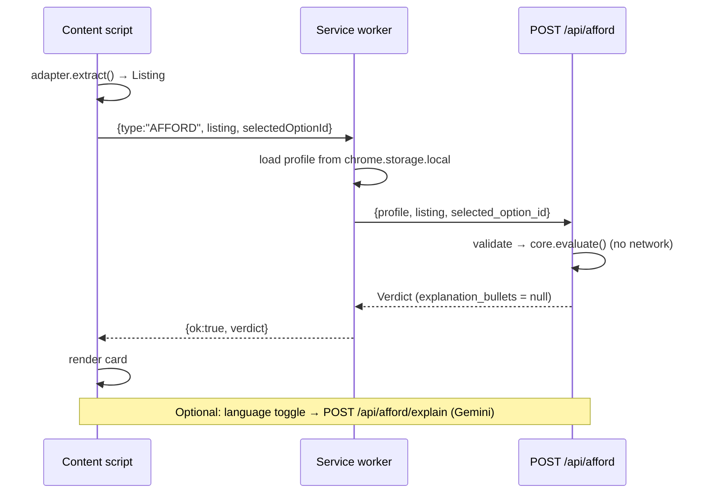

# ARCHITECTURE.md: Paylens Affordability Copilot

> Status: living document. **If code and this file disagree, stop and report it** (see PLAN.md §Working agreements). Update the Decisions Log (§16) whenever you deviate.
> Numbers and formulas live in `docs/reference/` (Calculation Manual v2 + `engine_ref.py`). This file defines _structure_, not maths.

---

## 1. Purpose

Answer one question at the moment of purchase: **"Can I afford this, and how?"**
The answer is computed from a **verified payslip profile**, not self-declared income, and shown on the shopping page by a browser extension.

### Principles (non-negotiable)

| #   | Principle                                                                                              | Consequence                                                                                 |
| --- | ------------------------------------------------------------------------------------------------------ | ------------------------------------------------------------------------------------------- |
| P1  | **LLMs never do arithmetic.** Gemini reads (payslips, page text) and explains (finished numbers).      | All numbers come from `app/core`. Explanations are validated against the Verdict (§9).      |
| P2  | **Stateless backend, profile in the browser.**                                                         | No database, no accounts in the core path. Profile JSON is sent with each request.          |
| P3  | **Explainable by hand.** Every figure can be re-worked from the manual.                                | One scoring function; thresholds in one config object; oracle test against `engine_ref.py`. |
| P4  | **Honest verdicts.** Alternatives are re-scored by the same function; infeasible paths are hidden.     | No hand-written advice strings that bypass the engine.                                      |
| P5  | **Degrade, never freeze.** Every external dependency has a fallback (§11).                             | The demo cannot be broken by Gemini, network or a retailer DOM change.                      |
| P6  | **Privacy by construction.** Raw payslips are never stored; browsing history never leaves the browser. | See §10.                                                                                    |

---

## 2. System overview

```
┌────────────────────────── Chrome (Manifest V3) ──────────────────────────┐
│  Shop page                                                               │
│   ┌──────────────────────┐   runtime.sendMessage   ┌──────────────────┐  │
│   │ content script        │ ──────────────────────▶ │ service worker    │  │
│   │  adapter → Listing    │ ◀────────────────────── │  storage, install │  │
│   │  shadow-DOM card      │      Verdict / error    │  id, API client   │  │
│   └──────────────────────┘                          └────────┬─────────┘  │
│   Options page (onboarding, profile)   Popup (status, switch)│            │
└──────────────────────────────────────────────────────────────┼────────────┘
                                                               │ HTTPS JSON
                                                               ▼
                         ┌───────────────────── FastAPI (Cloud Run) ─────────────────────┐
                         │ app/api   routes, validation, rate limit, errors, static mock  │
                         │    │                          │                                │
                         │    ▼                          ▼                                │
                         │ app/core  (PURE)         app/ai  (only Gemini caller)          │
                         │  tax · irr · profile ·    extract_payslip · extract_listing ·  │
                         │  engine · stress ·        explain · client                     │
                         │  alternatives · validate                                       │
                         └────────────────────────────────────────────────────────────────┘
```

### Primary flow (affordability check)



---

## 3. Repository layout

```
paylens/
├── app/
│   ├── main.py                 # app factory, CORS, error handlers, mounts /mock-shop
│   ├── config.py               # env-driven Settings (infra only: keys, limits, model, CORS)
│   ├── api/
│   │   ├── deps.py             # X-Install-Id, rate limit, circuit breaker (AI routes only)
│   │   ├── errors.py           # error envelope + exception handlers
│   │   ├── routes_afford.py    # /api/afford, /api/afford/explain
│   │   ├── routes_profile.py   # /api/profile/build, /api/demo/profiles
│   │   └── routes_listing.py   # /api/listing/parse
│   ├── core/                   # PURE PYTHON. See §4 for rules
│   │   ├── schemas.py          # Pydantic contracts (source of truth)
│   │   ├── thresholds.py       # frozen dataclass of all tunable constants + DEFAULT
│   │   ├── tax.py              # FY25-26/26-27 new & old regime, HRA
│   │   ├── irr.py              # bisection solver, EAR, nominal, reverse EMI
│   │   ├── profile.py          # derive essentials, free cash, runway, ceilings
│   │   ├── engine.py           # evaluate(): tiers, worst-tier verdict, High-Cost alert
│   │   ├── stress.py           # income −20%, regime-aware March shock
│   │   ├── alternatives.py     # buy-cash, wait-and-save, down-payment, longer-tenure
│   │   └── validate.py         # payslip gates G1–G3, health score
│   └── ai/                     # ONLY place that imports google.genai
│       ├── client.py           # lazy client init, timeout, retry, daily cap hook
│       ├── extract_payslip.py
│       ├── extract_listing.py
│       └── explain.py          # bullets + numeric-grounding guard
├── extension/                  # MV3, no build step (plain JS modules)
├── mock-shop/                  # static storefront, the guaranteed demo surface
├── docs/reference/             # Calculation Manual v2 (PDF) + engine_ref.py (oracle)
├── scripts/compute_fixtures.py # imports app.core only; prints golden numbers
├── samples/                    # synthetic payslips + ground_truth.json
├── tests/{core,api,fixtures}/
├── Dockerfile · deploy_to_cloud.py · requirements.txt · README.md
├── ARCHITECTURE.md · PLAN.md
```

---

## 4. Layering and dependency rules

```
api ──▶ core
api ──▶ ai ──▶ core.schemas   (ai may import schemas only)
core ──▶ (nothing else in app; stdlib + pydantic only)
```

| Layer      | May import                                    | Must not import                                                                                                                     |
| ---------- | --------------------------------------------- | ----------------------------------------------------------------------------------------------------------------------------------- |
| `app/core` | stdlib, `pydantic`, other `app.core` modules  | `app.ai`, `app.api`, `app.config`, `google*`, `fastapi`, `starlette`, `httpx`, `requests`, `os.environ` access, file or network I/O |
| `app/ai`   | `app.core.schemas`, `google.genai`, stdlib    | `app.api`, any core module other than `schemas`                                                                                     |
| `app/api`  | `app.core`, `app.ai`, `fastapi`, `app.config` | n/a                                                                                                                                 |

**Enforcement:** `tests/core/test_architecture.py` (AST scan with `rglob`, absolute _and_ relative imports). Add a second test asserting `app/ai` does not import `app.api`.

**Thresholds:** all tunable constants live in `app/core/thresholds.py` as a frozen dataclass with defaults. Engine functions take `th: Thresholds = DEFAULT`. `app/config.py` may construct an override from env and pass it in; core never reads env.

---

## 5. Data contracts

`app/core/schemas.py` is the **source of truth**; this section explains intent. Field tags: **[P]** payslip, **[U]** user input, **[D]** derived by core.

### VerifiedProfile (stored in the extension, sent on every request)

- Identity/versioning: `schema_version` (semver string), `profile_id` (uuid generated in the extension).
- Income **[P]**: `gross_monthly`, `basic_monthly`, `hra_monthly`, `pf_employee_monthly`, `professional_tax_monthly`, `tds_monthly`, `in_hand_verified` (excludes annual variable pay).
- User inputs **[U]**: `tax_regime`, `declared_80c`, `declared_80d`, `annual_variable_bonus`, `rent_monthly`, `is_metro`, `existing_emis[{name, monthly_amount, tenure_remaining_months}]`, `current_savings`, `language_pref`.
- Derived **[D]** (recomputed by core; **client-sent values are never trusted**): `essentials_monthly`, `emergency_runway_months`, `free_cash_monthly`, `safe_emi_ceiling`, `cushion_target`, `saving_pool`.
- `validation`: result of gates G1–G3 (`passed`, `warnings[]`, `needs_review_fields[]`).

### Listing (produced by an adapter or by `/api/listing/parse`)

- `product_id`, `title`, `category`, `retailer`, `upfront_cash_price` (list price), `cash_discount`.
- `effective_cash_price` **[D]**: derived server-side as `upfront_cash_price − cash_discount`. A mismatching client value is rejected with `VALIDATION`.
- `payment_options[]`: `option_id`, `type` (enum `CASH | NO_COST_EMI | STANDARD_EMI | BNPL`), `label`, `tenure_months`, `monthly_installment`, `upfront_downpayment`, `processing_fee` (pre-GST), `lost_cash_discount` (null for CASH), `stated_interest_rate`.

### Verdict (response of `/api/afford`)

- `verdict_level`, `badge`, `headline_reason` (template string, not LLM).
- `selected_option`, `true_cost` (`effective_annual_rate`, `nominal_annual_rate`, `total_outflow`, `hidden_markup`, `is_truly_zero_cost`, `high_cost_alert`).
- `impact` (`foir_before/after`, `free_cash_before/after`, `free_cash_ratio_after`, `runway_before/after`) and `tiers` (per-metric tier so the UI can explain _which_ metric drove the verdict).
- `stress_tests[]` (rows with `applicable=false` are not rendered), `alternatives[]` (each carries its own re-scored verdict + `hypothetical` flag).
- `assumptions[]`: human-readable list of assumptions used (essentials heuristic, GST on fee only, −20% stress), rendered in the card.
- `explanation_bullets`: nullable; filled only by `/api/afford/explain`.

### Versioning

- `schema_version` major mismatch → `422 UNSUPPORTED_SCHEMA`. Minor additions must be backward compatible. Extension migrates stored profiles on load.

---

## 6. Engine model (summary; maths in the manual)

Pipeline inside `/api/afford`:

1. **Validate** inputs; recompute derived profile fields; derive `effective_cash_price`.
2. **True cost** (`irr.py`): net financed = cash price − down payment − fee×1.18; bisection → monthly _r_; EAR and nominal; outflow; markup; High-Cost alert.
3. **Impact** (`engine.evaluate`): FOIR, free cash, free-cash ratio, runway after (savings − upfront outlay).
4. **Verdict** = worst tier across FOIR, free-cash ratio, runway. APR never sets the tier.
5. **Stress** (`stress.py`): income −20%; March shock (hidden when 0).
6. **Alternatives** (`alternatives.py`): each is a concrete state fed back into `evaluate()`.
7. **Assemble** Verdict. Target latency < 50 ms, no I/O.

**Single scoring function:** `evaluate(profile, new_emi, upfront, *, in_hand=None, savings=None, existing_emi=None, th=DEFAULT)`. Main option, stress cases and every alternative go through it. Adding a second scoring path is a defect.

**Oracle:** `docs/reference/engine_ref.py` is an independent reference implementation. `tests/core/test_oracle.py` asserts `app.core` equals it (±₹0.01, ±1e-6 on rates) on the golden fixtures and on randomised profiles.

---

## 7. API surface

All JSON. Base path `/api`. Errors use one envelope (§7.3).

### 7.1 Endpoints

| Method + path              | Purpose                                                               | AI? | Rate-limited | Notes                                   |
| -------------------------- | --------------------------------------------------------------------- | --- | ------------ | --------------------------------------- |
| `POST /api/afford`         | `{profile, listing, selected_option_id}` → Verdict                    | No  | **No**       | Pure; p95 < 50 ms.                      |
| `POST /api/afford/explain` | `{verdict, language}` → `{bullets[], source}`                         | Yes | Yes          | `source` is `"gemini"` or `"template"`. |
| `POST /api/profile/build`  | multipart payslip + user inputs → `{profile, extraction, validation}` | Yes | Yes          | ≤5 MB; PDF/PNG/JPG; no persistence.     |
| `POST /api/listing/parse`  | `{url, page_title, text}` → Listing                                   | Yes | Yes          | Fallback only.                          |
| `GET /api/demo/profiles`   | Demo personas (Rahul, Amit, Priya)                                    | No  | No           | Single source for onboarding demo data. |
| `GET /api/health`          | `{status, version, ai_available}`                                     | No  | No           | Used by smoke deploy.                   |
| `GET /mock-shop/*`         | Static storefront                                                     | n/a | n/a          | `StaticFiles`.                          |

### 7.2 Headers and limits

- `X-Install-Id` (uuid): **required on AI routes**, optional elsewhere (logged only). Missing on an AI route → `400 MISSING_INSTALL_ID`; do not fall back to IP.
- AI routes: sliding window 20 requests/hour per install id **and** a global daily Gemini cap (default 300) as a circuit breaker. Over limit → `429 RATE_LIMITED` with `Retry-After`.
- In-memory counters are per instance and reset on cold start. Accepted for the hackathon; deploy with `--max-instances=1` to keep limits meaningful.
- Request body cap: 6 MB.

### 7.3 Error envelope

```json
{
  "error": {
    "code": "VALIDATION",
    "message": "human readable",
    "details": { "field": "listing.upfront_cash_price" }
  }
}
```

Codes: `VALIDATION` (422) · `UNSUPPORTED_SCHEMA` (422) · `OPTION_NOT_FOUND` (404) · `MISSING_INSTALL_ID` (400) · `FILE_TOO_LARGE` / `UNSUPPORTED_FILE` (400) · `RATE_LIMITED` (429) · `AI_UNAVAILABLE` (503, with `fallback` hint) · `INTERNAL` (500, no stack trace in body).

### 7.4 CORS

Background-script fetches use `host_permissions` and bypass page CORS. Still allow `localhost:8000`, the Cloud Run origin and `chrome-extension://*` explicitly; no wildcard with credentials.

---

## 8. Extension architecture (Manifest V3)

```
extension/
├── manifest.json
├── config.js                      # API_BASE default; overridden by settings
├── background/service_worker.js
├── content/
│   ├── content.js                 # orchestrator
│   ├── card.js · card.css         # shadow-DOM UI (CSS fetched as text, injected in shadow root)
│   └── adapters/{index.js, mock_shop.js, amazon.js(stretch)}
├── options/{options.html, options.js, options.css}   # onboarding + profile editor
├── popup/{popup.html, popup.js, popup.css}           # status + persona switch
└── icons/
```

### 8.1 Manifest essentials

- `permissions`: `["storage"]` (add `"activeTab"` only if used). `host_permissions`: localhost + Cloud Run origin.
- `content_scripts.matches`: `http://localhost:8000/mock-shop/*` and the Cloud Run `/mock-shop/*`. **No** `content_scripts.css` (CSS goes inside the shadow root). Expose `card.css` via `web_accessible_resources`.
- `options_ui`/`options_page` for onboarding (file pickers close popups).
- Service worker is **stateless**: never keep state in globals; read `chrome.storage.local` per message.

### 8.2 Storage schema (`chrome.storage.local`)

| Key                   | Value                                                           |
| --------------------- | --------------------------------------------------------------- |
| `paylens.installId`   | uuid, created in `runtime.onInstalled` (also lazily if missing) |
| `paylens.profile`     | `VerifiedProfile` JSON                                          |
| `paylens.settings`    | `{apiBase, language}`                                           |
| `paylens.lastVerdict` | optional cache for popup display                                |

### 8.3 Message protocol (content/options/popup → service worker)

All requests `{type, payload}`; all replies `{ok: true, data} | {ok: false, error:{code,message}}`.

| `type`             | payload                       | reply `data`                        |
| ------------------ | ----------------------------- | ----------------------------------- |
| `AFFORD`           | `{listing, selectedOptionId}` | Verdict                             |
| `EXPLAIN`          | `{verdict, language}`         | `{bullets, source}`                 |
| `PROFILE_GET`      | none                          | VerifiedProfile or null             |
| `PROFILE_SET`      | VerifiedProfile               | saved profile                       |
| `PROFILE_BUILD`    | `{fileBase64, mime, inputs}`  | `{profile, extraction, validation}` |
| `DEMO_PROFILES`    | none                          | list of personas                    |
| `SETTINGS_GET/SET` | settings                      | settings                            |

Service worker rules: 8 s fetch timeout; one retry on network error for `AFFORD` only; always attach `X-Install-Id`; map HTTP errors to the §7.3 codes.

### 8.4 Adapter contract

```js
// adapters/<site>.js
export default {
  id: "mock_shop",
  matches(url) -> boolean,
  extract(document) -> Listing | null,     // normalised to the Listing schema (no derived fields)
  selectedOptionId(document) -> string | null,
  mountPoint(document) -> Element,         // where the card is inserted
  observe(document, onChange) -> disconnect // MutationObserver on option selection / price change
};
```

- `extract` returns `null` (never throws) when it cannot parse; the orchestrator then tries the Gemini fallback if enabled.
- Re-evaluate on option change, debounced 150 ms; ignore identical consecutive requests.

### 8.5 Mock-shop DOM contract

```html
<section
  data-pl-product
  data-pl-id="iphone_16_pro"
  data-pl-title="..."
  data-pl-category="Smartphone"
  data-pl-list-price="119900"
  data-pl-cash-discount="5000"
>
  <div data-pl-option data-pl-id="cash_upfront" data-pl-type="CASH" ...></div>
  <div
    data-pl-option
    data-pl-id="hdfc_nocost_6m"
    data-pl-type="NO_COST_EMI"
    data-pl-tenure="6"
    data-pl-emi="19983.33"
    data-pl-fee="199"
    data-pl-down="0"
    data-pl-lost-discount="5000"
    data-pl-rate="0"
    role="radio"
    aria-checked="true"
  ></div>
  <div data-pl-mount></div>
</section>
```

The selected option is the one with `aria-checked="true"`. Real-retailer adapters are best-effort and never required for the demo.

### 8.6 Card UI contract

- Rendered in an **open** shadow root attached to a host element inserted at `mountPoint`.
- States: `loading` → `verdict` | `no-profile` | `error` (with retry) | `offline-fallback`.
- Verdict view order: badge + one-line reason → true cost (EAR, nominal, markup, High-Cost alert) → impact (FOIR, free cash, runway) → stress rows → alternatives (each with its own badge; hypothetical ones labelled) → assumptions (collapsed).
- **Never rely on colour alone**: every tier shows text and an icon. Every number displayed comes from the Verdict; the UI does no financial arithmetic (formatting only).

---

## 9. AI layer rules (`app/ai`)

- Model/config from `app/config.py`; `temperature=0`; structured JSON output validated with Pydantic; 20 s timeout; max 1 retry.
- **Extraction** (payslip, listing): returns raw fields + per-field `confidence` where available. Python validates (gates) and never "fixes" numbers silently.
- **Explain** (`explain.py`): input is a finished Verdict. After generation, **numeric grounding guard**: extract all numbers from the bullets; each must appear (after formatting normalisation) in the Verdict or the profile. If any does not, discard the Gemini output and return the template bullets (`source:"template"`). This is the mechanical enforcement of P1.
- Templates for English, Hindi, Kannada live in `app/ai/templates.py` (static strings with named placeholders filled by Python).
- No payslip content or listing text is logged. Log only: route, status, latency, token counts, install-id hash.
- If Gemini is unavailable or the daily cap is hit: raise `AI_UNAVAILABLE`; routes fall back per §11.

---

## 10. Security and privacy

| Topic                    | Rule                                                                                                                                                                                            |
| ------------------------ | ----------------------------------------------------------------------------------------------------------------------------------------------------------------------------------------------- |
| Data leaving the browser | Profile numbers + listing terms to `/api/afford`; payslip file only to `/api/profile/build`. No URLs/history except in `/api/listing/parse` (explicit fallback).                                |
| Persistence              | Server persists nothing. No DB, no temp files (process uploads in memory, discard).                                                                                                             |
| Logging                  | No PII, no financial values, no file content. Install id logged as a short hash.                                                                                                                |
| Input safety             | Size/MIME checks; Pydantic validation with bounds (e.g. amounts ≥ 0 and < ₹1e9, tenure 1–84); reject NaN/inf.                                                                                   |
| Secrets                  | Gemini via ADC on Cloud Run or env key locally; never in the extension.                                                                                                                         |
| Extension                | Minimal permissions; no `<all_urls>`; no remote code; shadow DOM so page CSS/JS cannot read or restyle the card's internals (open root is used for debugging; revisit `closed` before release). |
| Disclaimer               | Card shows "Guidance with transparent maths, not financial advice."                                                                                                                             |

---

## 11. Failure and degraded modes

| Failure                        | Behaviour                                                                                                                                                                                  |
| ------------------------------ | ------------------------------------------------------------------------------------------------------------------------------------------------------------------------------------------ |
| Backend unreachable            | Card shows error state with retry; popup shows "offline". No cached fake verdict.                                                                                                          |
| `/api/afford` validation error | Card shows "couldn't read this listing" with a link to report; logs the field.                                                                                                             |
| Adapter cannot parse           | Orchestrator tries `/api/listing/parse` if enabled; otherwise shows "unsupported page".                                                                                                    |
| Gemini down / quota            | `/api/profile/build` → `AI_UNAVAILABLE` + `fallback:"manual_entry"`; options page opens the manual form pre-filled from sample data if `PAYLENS_OFFLINE=1`. `/explain` → template bullets. |
| Payslip gates fail             | Profile saved only after the user confirms flagged fields; flagged fields marked in UI.                                                                                                    |
| No profile in storage          | Card shows "Set up your profile" button → options page.                                                                                                                                    |
| Rate limit hit                 | 429 → card shows "AI features paused; verdict still available" (afford is unaffected).                                                                                                     |

---

## 12. Testing strategy

| Layer        | Tests                                                                                                             | Gate                          |
| ------------ | ----------------------------------------------------------------------------------------------------------------- | ----------------------------- |
| Core unit    | tax, irr, profile, engine, stress, alternatives, validate                                                         | `pytest tests/core`           |
| **Oracle**   | `app.core` vs `docs/reference/engine_ref.py`, golden fixtures + randomised profiles                               | must pass before any API work |
| Architecture | import rules (§4)                                                                                                 | must pass always              |
| API          | FastAPI `TestClient`: happy path, validation errors, schema mismatch, rate limit, install-id rules; Gemini mocked | `pytest tests/api`            |
| AI           | grounding guard unit tests with canned model outputs; extraction schema parsing with recorded responses           | no live Gemini in CI          |
| Extension    | Manual E2E checklist on mock shop (PLAN.md §3.7); optional Playwright smoke if time                               | checklist signed off          |
| Benchmark    | `benchmark_extraction.py` on synthetic payslips, reported as **synthetic**                                        | informational                 |

**Golden fixtures** live in `tests/fixtures/*.json` and are generated by `scripts/compute_fixtures.py`. They change only with explicit approval and a Decisions Log entry.

---

## 13. Configuration

| Variable                                        | Default               | Purpose                              |
| ----------------------------------------------- | --------------------- | ------------------------------------ |
| `GEMINI_MODEL`                                  | `gemini-2.5-flash`    | Model name                           |
| `GOOGLE_CLOUD_PROJECT`, `GOOGLE_CLOUD_LOCATION` | unset                 | Vertex AI (ADC)                      |
| `GEMINI_API_KEY`                                | unset                 | Local alternative                    |
| `PAYLENS_OFFLINE`                               | `0`                   | `1` = never call Gemini; use samples |
| `RATE_LIMIT_PER_HOUR`                           | `20`                  | AI routes per install id             |
| `GEMINI_DAILY_CAP`                              | `300`                 | Global circuit breaker               |
| `CORS_ORIGINS`                                  | localhost + Cloud Run | Comma-separated                      |
| `MAX_UPLOAD_MB`                                 | `5`                   | Payslip upload cap                   |

Engine thresholds are **not** env-driven; they are defaults in `core/thresholds.py` (override only via explicit code path for tests).

---

## 14. Deployment

- Docker `python:3.12-slim`; `uvicorn app.main:app --host 0.0.0.0 --port $PORT`; Cloud Run `asia-south1`, `--max-instances=1`, `--allow-unauthenticated`.
- `requirements.txt` minimal: `fastapi`, `uvicorn`, `pydantic`, `python-multipart`, `google-genai`, and test deps in a separate `requirements-dev.txt`. Remove Firestore and Cloud Translation.
- Extension is loaded unpacked for the demo; `apiBase` switches between localhost and the Cloud Run URL in settings.
- Smoke test after every deploy: `GET /api/health`, `POST /api/afford` with a golden fixture, open `/mock-shop/`.

---

## 15. Out of scope (for now)

Authentication and sync, retailer adapters beyond the mock (Amazon.in is a stretch), monthly auditing across payslips, card-reward optimisation, mobile, Firefox/Safari builds, any server-side storage.

**Seams left for later:** versioned self-contained profile JSON (sync = store that object); `X-Install-Id` (swap for a verified token); `paylens.ledger` storage key reserved for the EMI ledger; adapter registry for new retailers.

---

## 16. Decisions log

| #   | Decision                                                                                                               | Status   | Notes                                                                                   |
| --- | ---------------------------------------------------------------------------------------------------------------------- | -------- | --------------------------------------------------------------------------------------- |
| D1  | Stateless backend; profile lives in the extension                                                                      | Accepted | Privacy pitch; no auth in core path.                                                    |
| D2  | Verdict = worst tier of FOIR, free-cash ratio, runway; APR is a separate alert                                         | Accepted | Alert: EAR > 18% and markup ≥ min(₹1,500, 5% of cash price).                            |
| D3  | Essentials = rent + 30% (metro) / 25% (tier-2) of in-hand; EMIs excluded                                               | Accepted | Heuristic; shown as an assumption.                                                      |
| D4  | Wait & Save saves `min(saving_pool, free_cash)` per month; pool = 25% (metro) / 30% (tier-2) of in-hand; EMIs roll off | Accepted | Replaces "save all free cash". iPhone ⇒ 5 months.                                       |
| D5  | GST 18% on processing fee only; GST on interest not modelled                                                           | Accepted | Documented limitation.                                                                  |
| D6  | Runway after = (savings − down payment − fee incl. GST) ÷ essentials                                                   | Accepted |                                                                                         |
| D7  | Expose both EAR and nominal rate                                                                                       | Accepted | Banks quote nominal.                                                                    |
| D8  | Derived profile fields and `effective_cash_price` are recomputed server-side                                           | Accepted | Client values never trusted.                                                            |
| D9  | Onboarding on the options page, not the popup                                                                          | Accepted | Popups close on file pickers.                                                           |
| D10 | Rahul `annual_variable_bonus` = ₹1,59,312 (12.0 LPA incl. gratuity)                                                    | Accepted | Replaces ₹1,82,400, which ignored gratuity.                                             |
| D11 | March shock spread over the last N months (default 3: Jan–Mar) and capped at in-hand                                   | **Open** | Antigravity's ₹1,27,800 single-month spike exceeds a month's pay. Decide in PLAN 1.5.6. |
| D12 | Closed vs open shadow root for release                                                                                 | Open     | Open during development.                                                                |
