# PIVOT_PLAN.md — Paylens Affordability Copilot (MV3 Browser Extension)

> **Core Thesis:** *"Can I afford this, and how?"*  
> An automated, zero-deception affordability copilot powered by a verified payslip "truth layer", bisection IRR true-APR solver, and a Chrome Manifest V3 extension active at point-of-sale.

---

## 1. Codebase Audit & Reuse Readiness

### File-by-File Reuse Audit

| File | Public API / Key Functions | Purity | Verdict | Rationale & Action |
| :--- | :--- | :--- | :--- | :--- |
| [`tax.py`](file:///home/shamblonaut/dev/clones/paylens/tax.py) | `calculate_new_regime_tax(gross)`<br>`calculate_old_regime_tax(...)`<br>`calculate_hra_exemption(...)`<br>`compare_tax_regimes(TaxInput)` | **100% Pure** (Pydantic + math only, no network/globals) | **Lift As-Is** | Deterministic FY 2025-26 tax & take-home calculations. All 6 unit tests pass. Moved to `app/core/tax.py`. Used dynamically to calculate take-home pay and regime-aware March TDS shocks. |
| [`emi.py`](file:///home/shamblonaut/dev/clones/paylens/emi.py) | `safe_emi(...)`<br>`loan_capacity(...)`<br>`effective_annual_rate(...)`<br>`evaluate_affordability_lens(...)` | **100% Pure** (Deterministic math & bisection solver) | **Refactor** | Lift `effective_annual_rate` (IRR bisection) to `app/core/irr.py` (exposing both EAR and nominal APR). Replace `evaluate_affordability_lens` with the richer `AffordabilityEngine` in `app/core/engine.py`. |
| [`extract.py`](file:///home/shamblonaut/dev/clones/paylens/extract.py) | `extract_payslip_from_bytes(...)`<br>`extract_offer_from_bytes(...)`<br>`extract_price_quote_from_bytes(...)`<br>`generate_financial_explanation(...)` | **Entangled** (`google.genai`, network, `config.settings`) | **Refactor & Split** | Separate pure Pydantic schemas into `app/core/schemas.py`. Isolate Gemini OCR into `app/ai/extract_payslip.py`, explanation into `app/ai/explain.py`, and delete unused offer extraction. |
| [`auditor.py`](file:///home/shamblonaut/dev/clones/paylens/auditor.py) | `audit_monthly_payslips(payslips, state)` | **Pure Logic** (but currently imports from `extract.py`) | **Harvest & Port** | Multi-slip audit is out of the core extension path. Harvest the TDS spike detection logic directly into the dynamic stress-test engine (`app/core/stress.py`). |
| [`plan.py`](file:///home/shamblonaut/dev/clones/paylens/plan.py) | `generate_life_plan(...)`<br>`format_parent_letter(...)` | **100% Pure** | **Harvest & Delete** | 50-30-20 budget and parent WhatsApp letter are out of scope for shopping. Harvest the 3-month emergency cushion and essentials ratio formulas into `app/core/engine.py`. |
| [`offer.py`](file:///home/shamblonaut/dev/clones/paylens/offer.py) | `decode_offer(...)`<br>`compare_two_offers(...)` | **100% Pure** | **Harvest & Delete** | Offer comparison is retired. Harvest the variable-pay haircut rule (>15% variable pay discounted to 0% in worst-case) into `app/core/stress.py`. |
| [`translate.py`](file:///home/shamblonaut/dev/clones/paylens/translate.py) | `get_ui_labels(language)` | **Entangled** (Top-level `google.cloud.translate_v2` import) | **Rewrite** | Drop Google Cloud Translation API. Keep static pre-bundled strings or Gemini prompt localization in `app/ai/explain.py` for Hi/Kn explanation bullets only. |
| [`config.py`](file:///home/shamblonaut/dev/clones/paylens/config.py) | `Settings` | **Pure** (`os.getenv`) | **Refactor** | Remove Firestore references. Add engine thresholds (`SAFE_FOIR_MAX`, `STRETCH_FOIR_MAX`, `EMERGENCY_CUSHION_MONTHS`) and rate limits. Moved to `app/config.py`. |
| [`main.py`](file:///home/shamblonaut/dev/clones/paylens/main.py) | FastAPI routes, Firestore saves, IP rate limiter | **Entangled** (Firestore, in-memory state, monolithic routes) | **Rewrite** | Replace with modern modular FastAPI layout (`app/main.py` + `app/api/`). Remove Firestore entirely. Make backend 100% stateless and mount `mock-shop/` via `StaticFiles`. |

---

### Correctness & Logic Risks Identified in Audit

1. **`tax.py` Margins & Dynamic Shock Derivation**:
   - Standard deduction (₹75k) and Section 87A rebate (₹12L) for FY 2025-26 are implemented correctly with marginal relief (`min(raw_tax, excess_income)`).
   - *Dynamic Shock Calculation*: We derive March TDS shock directly via `tax.py`:
     - Under New Regime for taxable income $\le ₹12,00,000$ (like Rahul at ₹9.6L gross), statutory tax is ₹0.00 without needing any investment proofs, so March shock is ₹0.00.
     - Under Old Regime (like Vikram at ₹12L gross), if declarations (80C & HRA) are disallowed due to missed proofs in Jan/Feb, tax jumps to full unproven slab liability (₹163,800), triggering an acute ₹127,800 March deduction spike!
2. **`emi.py` Bisection IRR Solver & Compounding Rates**:
   - Mathematically sound convergence (`npv_diff` monotonically decreases with `m`; bisection runs 60 iterations to $< 1e-5$ precision).
   - Exposes both **Effective Annual Rate (EAR)** ($((1+m)^{12}-1)\times 100$) and **Nominal Annual Percentage Rate (APR)** ($m \times 12 \times 100$).
   - Accurately integrates 18% GST on processing fees and models the forfeiture of upfront cash discounts.

---

### Extraction Pipeline Assessment

- **Fields Returned by `extract.py`**:
  `employee_name`, `company_name`, `pay_period`, `basic`, `hra`, `special_allowance`, `other_earnings`, `gross_monthly`, `pf_employee`, `professional_tax`, `tds`, `other_deductions`, `net_pay`.
- **Reliability vs Missing**:
  - *Rock-solid (>95% accuracy in benchmarks)*: `gross_monthly`, `basic`, `pf_employee`, `net_pay`, `company_name`.
  - *Frequently zero/missing*: `hra` (consolidated pay), `tds` (nil for early quarters or low brackets), `other_deductions`.
- **Ground Truth & Benchmarks**:
  [`benchmark_extraction.py`](file:///home/shamblonaut/dev/clones/paylens/benchmark_extraction.py) confirms high accuracy across clean PDFs ([`sample_1_demo_user.pdf`](file:///home/shamblonaut/dev/clones/paylens/samples/sample_1_demo_user.pdf)), mobile PNGs, and camera photos ([`sample_5_photo_payslip.jpg`](file:///home/shamblonaut/dev/clones/paylens/samples/sample_5_photo_payslip.jpg)).
- **Fallback Capability**:
  `extract.py` falls back gracefully to `None` on network failure, allowing options onboarding to display an empty template for manual user verification.

---

### Data Flow & Statelessness

- **Current Firestore Footprint**: Writes anonymous records to `sessions` collection inside `/api/analyze`.
- **Removal Impact**: **Zero negative impact.** Removing Firestore eliminates external credentials, cold starts, and makes the service 100% stateless.
- **Rate Limiting**:
  - Core evaluation (`/api/afford`) is **100% deterministic Python and NOT rate limited by Gemini quotas**.
  - Rate limiting via `X-Install-Id` (20 req/hour sliding window) is applied **only to AI endpoints** (`/api/profile/build`, `/api/listing/parse`, and on-demand `/api/afford/explain`).

---

### Test Suite Health & Baseline

- **Current Test Run**:
  - All 19 tests in `tests/core/` **PASS** in 0.38s!
  - `tests/core/test_architecture.py` passes using `rglob("*.py")`, verifying zero imports from `app.ai`, `google`, or `fastapi`.

---

### Frontend Assessment & Surface Separation

- **Surface Separation**:
  - **Onboarding & Profile Setup**: Moved entirely out of the action popup into a dedicated **Options Page** (`options/options.html`, opened via `chrome.runtime.openOptionsPage()`). This provides comfortable screen space for payslip drag-and-drop, full earnings review, rent/savings inputs, and sample pre-fills.
  - **Extension Popup** (`popup/popup.html`): Remains a lightweight, instant-load inspection widget (viewing verified take-home, current active EMIs, and switching demo profiles).
  - **Mock Shop**: Served statically by FastAPI at `/mock-shop` using `StaticFiles`.

---

## 2. Target Repository Structure

```
paylens/
├── app/
│   ├── __init__.py
│   ├── main.py                     # FastAPI entry point, CORS, mounts /mock-shop StaticFiles
│   ├── config.py                   # Pure Pydantic Settings (Gemini models, thresholds)
│   ├── api/
│   │   ├── __init__.py
│   │   ├── deps.py                 # Rate limiting ONLY for AI routes via X-Install-Id
│   │   ├── routes_afford.py        # POST /api/afford (100% deterministic core evaluation)
│   │   ├── routes_profile.py       # POST /api/profile/build (Payslip OCR -> VerifiedProfile)
│   │   └── routes_listing.py       # POST /api/listing/parse (AI fallback for page text)
│   ├── core/                       # 100% PURE PYTHON — ZERO NETWORK, ZERO GEMINI
│   │   ├── __init__.py
│   │   ├── schemas.py              # VerifiedProfile, Listing, PaymentOption, Verdict
│   │   ├── tax.py                  # Lifted from tax.py (FY 2025-26 New/Old regime take-home)
│   │   ├── irr.py                  # Lifted from emi.py (Bisection EAR / Nominal APR solver)
│   │   ├── engine.py               # Worst-tier Verdict scoring (FOIR, Free Cash, Runway)
│   │   ├── stress.py               # Stress test generator (Income -20%, tax.py March TDS shock)
│   │   └── alternatives.py         # Alternatives with EMI roll-off and savings reconciliation
│   └── ai/                         # ONLY PLACE CALLING GEMINI SDK
│       ├── __init__.py
│       ├── client.py               # Google GenAI client initialization (ADC / API Key)
│       ├── extract_payslip.py      # Multimodal OCR for payslips
│       ├── extract_listing.py      # LLM fallback for raw HTML/screenshot listing extraction
│       └── explain.py              # Optional 1-line reason + bullets in En, Hi, Kn
├── extension/                      # Manifest V3 Chrome Extension
│   ├── manifest.json               # MV3 declarations, permissions, options_page
│   ├── background/
│   │   └── service_worker.js       # Background API client, install ID, chrome.storage manager
│   ├── content/
│   │   ├── content.js              # Page scanner & Open Shadow DOM card injector
│   │   ├── card.css                # Scoped styles loaded directly inside Shadow DOM root
│   │   └── adapters/
│   │       ├── mock_shop.js        # DOM adapter for mock shopping site
│   │       └── amazon.js           # (Stretch) DOM adapter for Amazon.in product pages
│   ├── options/                    # Dedicated Onboarding & Profile Page
│   │   ├── options.html            # Drag-and-drop payslip upload, earnings review, rent/savings
│   │   ├── options.js              # Connects to /api/profile/build and saves to chrome.storage
│   │   └── options.css
│   ├── popup/                      # Quick status & profile switcher
│   │   ├── popup.html              # Extension action popup (active take-home, demo profile switcher)
│   │   ├── popup.js                # Profile viewer & options page launcher
│   │   └── popup.css
│   └── icons/                      # Real PNG icons (16, 48, 128)
│       ├── icon-16.png
│       ├── icon-48.png
│       └── icon-128.png
├── mock-shop/                      # Static Mock E-Commerce Store (Mounted at /mock-shop)
│   ├── index.html                  # Product listings (iPhone 16 Pro, MacBook, Sony ANC)
│   ├── style.css                   # Realistic e-commerce storefront styling
│   └── shop.js                     # Realistic EMI payment option drawers
├── scripts/
│   └── compute_fixtures.py         # Standalone test runner importing exclusively from app.core
├── samples/                        # Ground truth payslip PDFs, PNGs, and JSONs
├── tests/
│   ├── core/
│   │   ├── test_architecture.py    # Enforces ZERO imports from app.ai in app.core (using rglob)!
│   │   ├── test_tax.py             # Ported tax unit tests
│   │   ├── test_irr.py             # Ported IRR bisection tests
│   │   ├── test_engine.py          # Comfortable, Stretch, Risky test fixtures
│   │   ├── test_stress.py          # Stress test assertions (Income -20%, March TDS)
│   │   └── test_alternatives.py    # Re-scoring & EMI roll-off verification
│   └── api/
│       ├── test_routes_afford.py   # E2E test of /api/afford
│       └── test_routes_profile.py  # E2E test of /api/profile/build
├── Dockerfile                      # Cloud Run container definition
├── deploy_to_cloud.py              # Cloud Run deployment script
├── requirements.txt                # Minimized dependencies (fastapi, uvicorn, pydantic, google-genai)
└── README.md
```

### Architectural Enforcement Test (`tests/core/test_architecture.py`)
Uses `core_dir.rglob("*.py")` to ensure recursive inspection:

```python
import ast
from pathlib import Path

def test_core_has_zero_ai_or_cloud_dependencies():
    core_dir = Path(__file__).resolve().parent.parent.parent / "app" / "core"
    forbidden_prefixes = ("app.ai", "google", "fastapi")
    
    python_files = list(core_dir.rglob("*.py"))
    assert len(python_files) >= 5, f"Expected at least 5 core modules, found {len(python_files)}"
    
    for py_file in python_files:
        tree = ast.parse(py_file.read_text(encoding="utf-8"), filename=str(py_file))
        for node in ast.walk(tree):
            if isinstance(node, ast.Import):
                for alias in node.names:
                    for prefix in forbidden_prefixes:
                        assert not alias.name.startswith(prefix), (
                            f"Architectural Violation in {py_file.name}: imports forbidden module '{alias.name}'"
                        )
            elif isinstance(node, ast.ImportFrom):
                module = node.module or ""
                for prefix in forbidden_prefixes:
                    assert not module.startswith(prefix), (
                        f"Architectural Violation in {py_file.name}: imports from forbidden module '{module}'"
                    )
```

---

## 3. Data Contracts (Pydantic Schemas & Examples)

### Field Source Mapping
- **`[P]`**: Extracted directly from payslip OCR
- **`[U]`**: Supplied by user input / onboarding profile form
- **`[D]`**: Deterministically derived by Python core

```python
from enum import Enum
from typing import List, Optional, Any
from pydantic import BaseModel, Field, model_validator

# =====================================================================
# 1. ENUMS & SUB-MODELS
# =====================================================================
class PaymentType(str, Enum):
    CASH = "CASH"
    NO_COST_EMI = "NO_COST_EMI"
    STANDARD_EMI = "STANDARD_EMI"
    BNPL = "BNPL"

class ActiveEMI(BaseModel):
    name: str = Field(..., description="Item or loan description")
    monthly_amount: float = Field(..., description="Current monthly installment in INR")
    tenure_remaining_months: int = Field(..., description="Remaining installments before roll-off")

# =====================================================================
# 2. VERIFIED PROFILE
# =====================================================================
class VerifiedProfile(BaseModel):
    schema_version: str = Field("1.0.0", description="Schema version for sync migration")
    profile_id: str = Field(..., description="Anonymous UUID generated on install/onboarding")
    
    # Income (Truth Layer)
    employer_name: str = Field("Company", description="Employer name from payslip")
    pay_period: str = Field("Recent", description="Month & Year of payslip")
    gross_monthly: float = Field(..., description="Verified gross earnings from payslip")
    basic_monthly: float = Field(..., description="Basic salary component")
    hra_monthly: float = Field(0.0, description="House Rent Allowance")
    pf_employee_monthly: float = Field(0.0, description="EPF deduction")
    professional_tax_monthly: float = Field(200.0, description="Professional Tax")
    tds_monthly: float = Field(0.0, description="Declared monthly TDS deducted")
    tax_regime: str = Field("NEW", description="'NEW' or 'OLD' tax regime")
    
    # in_hand_verified: Standard monthly net take-home from the regular payslip.
    # EXCLUDES annual discretionary bonuses or variable performance pay.
    in_hand_verified: float = Field(..., description="Verified regular net monthly take-home")
    
    # Declared annual variable bonus from CTC/offer (not part of monthly guaranteed cash)
    annual_variable_bonus: float = Field(0.0, description="Declared annual non-guaranteed variable component")
    
    # Committed Expenses & Essentials
    rent_monthly: float = Field(0.0, description="Monthly rent obligation")
    is_metro: bool = Field(True, description="Metro city cost factor")
    existing_emis: List[ActiveEMI] = Field(default_factory=list, description="Active debt obligations")
    total_existing_emi_monthly: float = Field(0.0, description="Sum of active monthly EMIs")
    
    # Financial Cushion
    current_savings: float = Field(0.0, description="Liquid savings in bank account")
    essentials_monthly: float = Field(0.0, description="Baseline living cost (rent + 30% in-hand)")
    emergency_runway_months: float = Field(0.0, description="current_savings / essentials_monthly")
    
    # Affordability Capacity
    free_cash_monthly: float = Field(0.0, description="in_hand - total_existing_emi - essentials")
    safe_emi_ceiling: float = Field(0.0, description="Max recommended new EMI (35% in_hand - existing)")
    language_pref: str = Field("en", description="'en', 'hi', or 'kn'")

    @model_validator(mode="before")
    @classmethod
    def validate_derived_fields(cls, data: Any) -> Any:
        if isinstance(data, dict):
            in_hand = data.get("in_hand_verified", 0.0)
            rent = data.get("rent_monthly", 0.0)
            savings = data.get("current_savings", 0.0)
            emis = data.get("existing_emis", [])
            total_emi = sum(e["monthly_amount"] if isinstance(e, dict) else e.monthly_amount for e in emis)
            data["total_existing_emi_monthly"] = total_emi
            
            essentials = rent + (in_hand * 0.30)
            data["essentials_monthly"] = round(essentials, 2)
            data["emergency_runway_months"] = round(savings / essentials, 2) if essentials > 0 else 0.0
            data["free_cash_monthly"] = round(in_hand - total_emi - essentials, 2)
            data["safe_emi_ceiling"] = max(0.0, round((in_hand * 0.35) - total_emi, 2))
        return data

# =====================================================================
# 3. LISTING & PAYMENT OPTIONS
# =====================================================================
class PaymentOption(BaseModel):
    option_id: str = Field(..., description="Unique ID for option, e.g. 'hdfc_nocost_6m'")
    type: PaymentType = Field(..., description="Payment option type enum")
    label: str = Field(..., description="Display label, e.g. 'HDFC No-Cost EMI (6 Months)'")
    tenure_months: int = Field(1, description="Number of installments (1 for CASH)")
    monthly_installment: float = Field(..., description="Amount billed per month (INR)")
    upfront_downpayment: float = Field(0.0, description="Down payment required today (INR)")
    processing_fee: float = Field(0.0, description="Upfront documentation/processing charge")
    
    # Only applicable to EMI/BNPL options that forfeit the upfront cash discount.
    # Set to None for CASH option where the discount is captured.
    lost_cash_discount: Optional[float] = Field(None, description="Instant discount lost if taking EMI")
    stated_interest_rate: float = Field(0.0, description="Advertised annual interest rate (0% for No-Cost)")

class Listing(BaseModel):
    product_id: str
    title: str
    category: str = Field("Electronics", description="e.g. Smartphone, Laptop, Appliance")
    retailer: str = Field("MockStore", description="MockStore, Amazon, Flipkart")
    upfront_cash_price: float = Field(..., description="Sticker price before discounts (INR)")
    cash_discount: float = Field(0.0, description="Instant discount for upfront cash payment")
    
    # effective_cash_price = upfront_cash_price - cash_discount (True baseline benchmark)
    effective_cash_price: float = Field(..., description="Upfront cash price after instant discount")
    payment_options: List[PaymentOption]

# =====================================================================
# 4. VERDICT & IMPACT
# =====================================================================
class TrueCost(BaseModel):
    effective_annual_rate: float = Field(..., description="Effective Annual Rate (EAR) via bisection IRR")
    nominal_annual_rate: float = Field(..., description="Nominal Annual Percentage Rate (APR) = monthly_r * 12")
    total_outflow: float = Field(..., description="Total money paid over full tenure")
    hidden_markup: float = Field(..., description="Total extra cost vs effective cash price")
    is_truly_zero_cost: bool
    has_high_apr_alert: bool = Field(..., description="Flags high rate if EAR > 18% and markup >= min(1500, 5% price)")

class FinancialImpact(BaseModel):
    foir_before: float = Field(..., description="Fixed Obligation to Income Ratio before purchase")
    foir_after: float = Field(..., description="FOIR after taking this option")
    free_cash_before: float
    free_cash_after: float
    free_cash_ratio_after: float
    runway_months_before: float
    runway_months_after: float

class StressTestResult(BaseModel):
    scenario_name: str
    description: str
    stressed_foir: float
    stressed_free_cash: float
    passes: bool
    is_applicable: bool = True
    warning: Optional[str] = None

class AlternativeOption(BaseModel):
    strategy: str = Field(..., description="'BUY_CASH' | 'WAIT_AND_SAVE' | 'DOWNPAYMENT_BOOST'")
    title: str
    description: str
    suggested_monthly_emi: float
    suggested_tenure_months: int
    rescore_verdict: str
    rescore_badge: str
    runway_after: float
    money_saved: float
    is_feasible: bool = True

class Verdict(BaseModel):
    # Core Affordability: worst tier across (FOIR, FreeCash, Runway)
    verdict_level: str = Field(..., description="'COMFORTABLE' | 'STRETCH' | 'RISKY'")
    badge: str = Field(..., description="🟢 Safe to Buy | 🟡 Budget Stretch | 🔴 Risky Debt")
    headline_reason: str = Field(..., description="Concise, plain-language one-line verdict")
    selected_option: PaymentOption
    true_cost: TrueCost
    impact: FinancialImpact
    stress_tests: List[StressTestResult]
    alternatives: List[AlternativeOption]
    
    # Optional: populated on-demand or asynchronously to conserve AI quotas
    explanation_bullets: Optional[List[str]] = Field(None, description="Optional localized bullets")
```

### JSON Data Examples

#### `VerifiedProfile` Rahul (CTC ≈ 12 LPA) (`/tests/fixtures/profile_rahul.json`)
```json
{
  "schema_version": "1.0.0",
  "profile_id": "prof_rahul",
  "employer_name": "Acme Cloud Tech India Pvt Ltd",
  "pay_period": "March 2026",
  "gross_monthly": 80000.0,
  "basic_monthly": 40000.0,
  "hra_monthly": 20000.0,
  "pf_employee_monthly": 4800.0,
  "professional_tax_monthly": 200.0,
  "tds_monthly": 0.0,
  "tax_regime": "NEW",
  "in_hand_verified": 75000.0,
  "annual_variable_bonus": 182400.0,
  "rent_monthly": 18000.0,
  "is_metro": true,
  "existing_emis": [
    { "name": "Previous Phone", "monthly_amount": 3500.0, "tenure_remaining_months": 3 }
  ],
  "total_existing_emi_monthly": 3500.0,
  "current_savings": 150000.0,
  "essentials_monthly": 40500.0,
  "emergency_runway_months": 3.70,
  "free_cash_monthly": 31000.0,
  "safe_emi_ceiling": 22750.0,
  "language_pref": "en"
}
```

#### `VerifiedProfile` Amit (Overleveraged Junior Dev) (`/tests/fixtures/profile_amit.json`)
```json
{
  "schema_version": "1.0.0",
  "profile_id": "prof_amit",
  "employer_name": "Infosol Global",
  "pay_period": "March 2026",
  "gross_monthly": 50000.0,
  "basic_monthly": 25000.0,
  "hra_monthly": 10000.0,
  "pf_employee_monthly": 3000.0,
  "professional_tax_monthly": 200.0,
  "tds_monthly": 0.0,
  "tax_regime": "NEW",
  "in_hand_verified": 46800.0,
  "annual_variable_bonus": 0.0,
  "rent_monthly": 14000.0,
  "is_metro": false,
  "existing_emis": [
    { "name": "Bike Loan", "monthly_amount": 8000.0, "tenure_remaining_months": 8 }
  ],
  "total_existing_emi_monthly": 8000.0,
  "current_savings": 25000.0,
  "essentials_monthly": 28040.0,
  "emergency_runway_months": 0.89,
  "free_cash_monthly": 4760.0,
  "safe_emi_ceiling": 8380.0,
  "language_pref": "en"
}
```

---

## 4. API Surface & Specifications

### 1. `POST /api/profile/build` (AI Route — Rate Limited)
Builds a verified financial profile by performing multimodal OCR on a payslip and combining with user-declared rent/savings.

- **Request**: `multipart/form-data`
  - `file`: PDF / PNG / JPG file (max 5MB)
  - `rent_monthly`: `float` (default `0.0`)
  - `current_savings`: `float` (default `0.0`)
  - `existing_emis_json`: `string` (JSON array of `ActiveEMI`, default `[]`)
  - `annual_variable_bonus`: `float` (default `0.0`)
  - `tax_regime`: `string` ("NEW" | "OLD", default "NEW")
  - `is_metro`: `bool` (default `true`)
  - `language`: `string` ("en", "hi", "kn")
- **Header**: `X-Install-Id: <uuidv4>` (subject to install AI rate limit).
- **Response** (`200 OK`): `VerifiedProfile` JSON object.

### 2. `POST /api/afford` (Pure Core Route — NOT Rate Limited by AI Quotas)
Core stateless evaluation endpoint. 100% deterministic Python calculation executed in $< 25\text{ms}$.

- **Request**: `application/json`
  ```json
  {
    "profile": { /* VerifiedProfile object */ },
    "listing": { /* Listing object */ },
    "selected_option_id": "iphone_nocost_6m"
  }
  ```
- **Response** (`200 OK`): `Verdict` JSON object.
- **Note**: `explanation_bullets` defaults to `null` to ensure instantaneous response.

### 3. `POST /api/afford/explain` (AI Route — On-Demand)
Fetches localized 3-5 bullet explanations in English, Hindi, or Kannada when requested by the user.

- **Request**: `application/json` (`{ "verdict": { ... }, "language": "kn" }`)
- **Response** (`200 OK`): `{"bullets": ["..."]}`

### 4. `POST /api/listing/parse` (AI Fallback Only)
Fallback endpoint used only when extension DOM selector adapters fail to parse payment options from the store page.

---

## 5. Affordability Engine Design & Verified Fixtures

### Core Verdict Resolution: Worst-Tier Matrix
To prevent false-positive green verdicts, the core affordability verdict is strictly defined as the **worst tier among the three foundational budget metrics**:

$$\text{Verdict} = \max_{\text{severity}}\Big(\text{Tier}(\text{FOIR}), \text{Tier}(\text{FreeCashRatio}), \text{Tier}(\text{Runway})\Big)$$

| Metric | 🟢 COMFORTABLE | 🟡 STRETCH | 🔴 RISKY |
| :--- | :--- | :--- | :--- |
| **FOIR (Debt / Income)** | $\le 35.0\%$ | $35.0\% < \text{FOIR} \le 50.0\%$ | $> 50.0\%$ |
| **Free Cash Ratio** | $\ge 20.0\%$ of in-hand | $5.0\% \le \text{Ratio} < 20.0\%$ | $< 5.0\%$ (or cash deficit) |
| **Emergency Runway** | $\ge \text{EMERGENCY\_CUSHION\_MONTHS}$ ($3.0\text{m}$) | $2.0 \le \text{Runway} < 3.0$ months | $< 2.0$ months |

### Separation of APR from Budget Verdict
- **Design Principle**: A high APR does NOT directly downgrade a budget-safe purchase into a red verdict.
- **Financing Quality Badge**: A separate `High APR Alert` (🔴 High Cost Financing) is flagged if and only if:
  $$\text{Effective EAR} > 18.0\% \quad \mathbf{AND} \quad \text{Hidden Markup} \ge \min(₹1,500, \, 5\% \text{ of cash price})$$
  This highlights predatory markup where real rupees are lost, without corrupting the cash-flow verdict.

---

### Exact Verified Fixtures (Output from `scripts/compute_fixtures.py`)

Below is the verbatim terminal output generated by executing `python3 scripts/compute_fixtures.py`:

```
======================================================================
🟢 Scenario 1: Comfortable (Sony Headphones for Rahul)
======================================================================
Selected Option      : No-Cost EMI (6 Months)
Effective Cash Price : ₹27,990.00
Total Outflow via EMI: ₹30,224.80
Hidden Markup        : ₹2,234.80
Effective EAR        : 30.74%
Nominal APR          : 27.1%
FOIR Before -> After : 4.7% -> 11.3%
Free Cash After      : ₹26,001.67 (34.7% of in-hand)
Runway Before -> After: 3.70m -> 3.70m
Core Verdict         : COMFORTABLE (🟢 Safe to Buy)
Headline Reason      : Budget-safe (11.3% FOIR), but financing costs 30.74% EAR markup (₹2,235 lost).
High APR Alert       : True
----------------------------------------------------------------------
STRESS TESTS:
 - Income Shock (-20% Salary Cut): Passes | Stressed FOIR=14.2% | Stressed Free Cash=₹11,001.67
 - March TDS Shock (Tax Deduction Jump): Passes [Not Applicable] | Stressed FOIR=11.3% | Stressed Free Cash=₹26,001.67
----------------------------------------------------------------------
RE-SCORED ALTERNATIVES:
 • Buy in Cash Today (Full Payment) [Feasible]: Pay ₹27,990 upfront. Post-purchase runway is 3.01 months (₹122,010 savings left). (Verdict: COMFORTABLE 🟢 Safe to Buy, Post Runway: 3.01m, Saved: ₹2,235)
 • Buy with Surplus Savings Today [Feasible]: You already have ₹28,500 surplus above your 3-month cushion. You can buy today in cash and save ₹2,235! (Verdict: COMFORTABLE 🟢 Safe Goal, Post Runway: 3.00m, Saved: ₹2,235)
 • Hypothetical Part-Payment (₹11,196 Downpayment) [Feasible]: If the retailer supports split payment: pay ₹11,196 upfront from surplus savings. Drops monthly EMI to ₹2,799/mo while keeping 3-month runway. (Verdict: COMFORTABLE 🟢 Safe to Buy, Post Runway: 3.43m, Saved: ₹0)

======================================================================
🟡 Scenario 2: Stretch (iPhone 16 Pro for Rahul)
======================================================================
Selected Option      : No-Cost EMI (6 Months)
Effective Cash Price : ₹114,900.00
Total Outflow via EMI: ₹120,134.80
Hidden Markup        : ₹5,234.80
Effective EAR        : 16.63%
Nominal APR          : 15.49%
FOIR Before -> After : 4.7% -> 31.3%
Free Cash After      : ₹11,016.67 (14.7% of in-hand)
Runway Before -> After: 3.70m -> 3.70m
Core Verdict         : STRETCH (🟡 Budget Stretch)
Headline Reason      : Budget stretch: consumes 31.3% of your salary and shrinks free cash to ₹11,017.
High APR Alert       : False
----------------------------------------------------------------------
STRESS TESTS:
 - Income Shock (-20% Salary Cut): Fails | Stressed FOIR=39.1% | Stressed Free Cash=₹-3,983.33 | Warning: A 20% salary cut triggers an immediate deficit of ₹3,983/month.
 - March TDS Shock (Tax Deduction Jump): Passes [Not Applicable] | Stressed FOIR=31.3% | Stressed Free Cash=₹11,016.67
----------------------------------------------------------------------
RE-SCORED ALTERNATIVES:
 • Buy in Cash Today (Full Payment) [Feasible]: Pay ₹114,900 upfront. Post-purchase runway is 0.87 months (₹35,100 savings left). (Verdict: RISKY 🔴 Risky Debt, Post Runway: 0.87m, Saved: ₹5,235)
 • Wait 3 Months & Buy in Cash [Feasible]: Wait 3 months: save your uncommitted cash (₹31,000/mo) to buy in cash, saving ₹5,235 while keeping your 3-month emergency cushion intact. (Verdict: COMFORTABLE 🟢 Safe Goal, Post Runway: 3.00m, Saved: ₹5,235)
 • Hypothetical Part-Payment (₹28,500 Downpayment) [Feasible]: If the retailer supports split payment: pay ₹28,500 upfront from surplus savings. Drops monthly EMI to ₹14,400/mo while keeping 3-month runway. (Verdict: COMFORTABLE 🟢 Safe to Buy, Post Runway: 3.00m, Saved: ₹0)

======================================================================
🔴 Scenario 3: Risky (Gaming Laptop for Amit)
======================================================================
Selected Option      : Standard EMI (12 Months, 15% APR)
Effective Cash Price : ₹140,000.00
Total Outflow via EMI: ₹159,098.82
Hidden Markup        : ₹19,098.82
Effective EAR        : 27.44%
Nominal APR          : 24.49%
FOIR Before -> After : 17.1% -> 45.2%
Free Cash After      : ₹-2,400.00 (-5.1% of in-hand)
Runway Before -> After: 0.89m -> 0.89m
Core Verdict         : RISKY (🔴 Risky Debt)
Headline Reason      : Risky: triggers an immediate monthly cash-flow deficit of ₹2,400/month.
High APR Alert       : True
----------------------------------------------------------------------
STRESS TESTS:
 - Income Shock (-20% Salary Cut): Fails | Stressed FOIR=56.5% | Stressed Free Cash=₹-11,760.00 | Warning: A 20% salary cut triggers an immediate deficit of ₹11,760/month.
 - March TDS Shock (Tax Deduction Jump): Passes [Not Applicable] | Stressed FOIR=45.2% | Stressed Free Cash=₹-2,400.00
----------------------------------------------------------------------
RE-SCORED ALTERNATIVES:
 • Buy in Cash Today (Full Payment) [Not Possible]: Not possible today: upfront price (₹140,000) exceeds total savings (₹25,000). (Verdict: RISKY 🔴 Not Feasible, Post Runway: 0.89m, Saved: ₹0)
 • Build 3-Month Emergency Cushion First [Feasible]: Your current cushion is low (0.89m). Save ₹59,120 to build a 3-month safety fund before major discretionary purchases. (Verdict: COMFORTABLE 🟢 Safe Goal, Post Runway: 3.00m, Saved: ₹0)

======================================================================
🏢 Scenario 4: Old Regime March TDS Shock Persona (Vikram)
======================================================================
Selected Option      : No-Cost EMI (6 Months)
Effective Cash Price : ₹114,900.00
Total Outflow via EMI: ₹120,134.80
Hidden Markup        : ₹5,234.80
Effective EAR        : 16.63%
Nominal APR          : 15.49%
FOIR Before -> After : 0.0% -> 22.7%
Free Cash After      : ₹16,616.67 (18.9% of in-hand)
Runway Before -> After: 3.89m -> 3.89m
Core Verdict         : STRETCH (🟡 Budget Stretch)
Headline Reason      : Budget stretch: consumes 22.7% of your salary and shrinks free cash to ₹16,617.
High APR Alert       : False
----------------------------------------------------------------------
STRESS TESTS:
 - Income Shock (-20% Salary Cut): Fails | Stressed FOIR=28.4% | Stressed Free Cash=₹-983.33 | Warning: A 20% salary cut triggers an immediate deficit of ₹983/month.
 - March TDS Shock (Tax Deduction Jump): Fails | Stressed FOIR=22.7% | Stressed Free Cash=₹-111,183.33 | Warning: Unsubmitted 80C/HRA proofs trigger a ₹127,800 March tax deduction spike.
----------------------------------------------------------------------
RE-SCORED ALTERNATIVES:
 • Buy in Cash Today (Full Payment) [Feasible]: Pay ₹114,900 upfront. Post-purchase runway is 1.66 months (₹85,100 savings left). (Verdict: RISKY 🔴 Risky Debt, Post Runway: 1.66m, Saved: ₹5,235)
 • Wait 2 Months & Buy in Cash [Feasible]: Wait 2 months: save your uncommitted cash (₹36,600/mo) to buy in cash, saving ₹5,235 while keeping your 3-month emergency cushion intact. (Verdict: COMFORTABLE 🟢 Safe Goal, Post Runway: 3.00m, Saved: ₹5,235)
 • Hypothetical Part-Payment (₹45,800 Downpayment) [Feasible]: If the retailer supports split payment: pay ₹45,800 upfront from surplus savings. Drops monthly EMI to ₹11,517/mo while keeping 3-month runway. (Verdict: COMFORTABLE 🟢 Safe to Buy, Post Runway: 3.00m, Saved: ₹0)
```

> **Note on Discrepancy Resolution:**  
> In earlier drafts, a ₹105 / ₹135 discrepancy appeared because savings-left was multiplied from a rounded runway float (`3.01 * 40500 = 121,905` instead of `150,000 - 27,990 = 122,010`, and `0.87 * 40500 = 35,235` instead of `150,000 - 114,900 = 35,100`). In the engine, `savings_after = current_savings - downpayment` is now stored and printed directly, ensuring exact rupee precision.

---

## 6. Manifest V3 Extension Design

### Manifest Specification (`extension/manifest.json`)
```json
{
  "manifest_version": 3,
  "name": "Paylens — Point-of-Sale Affordability Copilot",
  "version": "1.0.0",
  "description": "True APR solver and verified paycheck affordability lens for shopping.",
  "permissions": [
    "storage",
    "activeTab"
  ],
  "host_permissions": [
    "http://localhost:8000/*",
    "https://*.run.app/*"
  ],
  "background": {
    "service_worker": "background/service_worker.js"
  },
  "options_page": "options/options.html",
  "action": {
    "default_popup": "popup/popup.html",
    "default_icon": {
      "16": "icons/icon-16.png",
      "48": "icons/icon-48.png",
      "128": "icons/icon-128.png"
    }
  },
  "content_scripts": [
    {
      "matches": [
        "http://localhost:8000/mock-shop/*",
        "https://*.run.app/mock-shop/*"
      ],
      "js": ["content/adapters/mock_shop.js", "content/content.js"],
      "run_at": "document_idle"
    }
  ],
  "icons": {
    "16": "icons/icon-16.png",
    "48": "icons/icon-48.png",
    "128": "icons/icon-128.png"
  }
}
```

### Shadow DOM Scoped Styles (Inside `content/content.js`)
To prevent host webpage styles from leaking into our verdict card and avoid extension CSP injection hurdles, `card.css` is injected directly inside an **open Shadow Root**:
```javascript
const host = document.createElement('div');
host.id = 'paylens-root';
const shadow = host.attachShadow({ mode: 'open' });
shadow.innerHTML = `
  <style>
    /* Scoped card styles directly in shadow root */
    .paylens-card { background: #0f172a; border: 1px solid #334155; border-radius: 12px; color: #f8fafc; font-family: sans-serif; padding: 16px; }
    .badge-comfortable { background: #10b981; color: #fff; padding: 4px 8px; border-radius: 6px; font-weight: bold; }
    .badge-stretch { background: #f59e0b; color: #fff; padding: 4px 8px; border-radius: 6px; font-weight: bold; }
    .badge-risky { background: #ef4444; color: #fff; padding: 4px 8px; border-radius: 6px; font-weight: bold; }
  </style>
  <div class="paylens-card">
    <div class="card-header">${verdict.badge}</div>
    <p class="card-reason">${verdict.headline_reason}</p>
  </div>
`;
document.querySelector('.price-container').appendChild(host);
```

---

## 7. Build Plan (8-Hour Hackathon)

### Calibrated Timeline (with Early Cloud Run Deploy)

```mermaid
gantt
    title Paylens Pivot Sprint (8-Hour Schedule)
    dateFormat HH:mm
    axisFormat %H:%M
    
    section Foundation & Early Cloud
    Define Data Contracts & test_architecture :done,    t1, 00:00, 00:45
    Pure Core Engine, IRR, Stress, Alts       :active,  t2, 00:45, 01:45
    Early Cloud Run Smoke Deploy              :         t3, 01:45, 02:15
    
    section API & Storefront
    FastAPI /api/afford & /mock-shop Static    :         t4, 02:15, 03:15
    POST /api/profile/build + Gemini OCR       :         t5, 03:15, 04:15
    
    section Extension MV3
    MV3 Options Onboarding & Popup            :         t6, 04:15, 05:15
    Content Script Open Shadow DOM & Adapter  :         t7, 05:15, 06:15
    
    section Integration & Polish
    End-to-End Extension + Mock Shop Loop     :         t8, 06:15, 07:15
    Final Cloud Run Deploy & Demo Rehearsal   :         t9, 07:15, 08:00
```



### Parallel Team Work Streams

| Role / Engineer | Hours 0:00–1:45 | Hours 1:45–3:15 | Hours 3:15–4:15 | Hours 4:15–6:15 | Hours 6:15–8:00 |
| :--- | :--- | :--- | :--- | :--- | :--- |
| **Engineer 1 (Backend Core & AI)** | Define schemas in `app/core/schemas.py`, lift `core/tax.py`, `core/irr.py`, write `core/engine.py`, `core/stress.py`, `core/alternatives.py`. Run `test_architecture.py`. | Deploy Early Cloud Run Smoke (`paylens-smoke`); implement `/api/afford` route. | Build `/api/profile/build` with Gemini OCR (`extract_payslip.py`) and schema validation. | Hook up `/api/afford/explain` for regional bullets (En/Hi/Kn); optimize latency. | Final Cloud Run deploy, smoke tests, and presentation prep. |
| **Engineer 2 (Extension & Storefront)** | Build static `mock-shop/` with Sony, iPhone, Laptop product pages & EMI drawers. | Mount `/mock-shop` in FastAPI; setup MV3 `manifest.json`, `service_worker.js`, and icons. | Build `options/options.html` (drag-and-drop payslip upload, earnings review, rent/savings). | Build `content/content.js` with open Shadow DOM injection and `mock_shop.js` adapter. | End-to-end integration testing on mock shop with all 3 personas. |
| **Engineer 3 (if 3-person team)** | Verify unit test fixtures from `scripts/compute_fixtures.py` across all scenarios. | Verify early Cloud Run smoke URL; design Shadow DOM card styles in `card.css`. | Write API integration tests (`tests/api/test_routes_profile.py`). | Test edge cases (deficit handling, roll-off accumulation, infeasible cash options). | (Optional stretch) Amazon.in DOM adapter script; rehearse 60-second live demo. |

### Must-Ship Cut Line vs Upside

| Layer | Must-Ship Demo Cut Line (Non-Negotiable) | Upside Items (Drop if Pressed for Time) |
| :--- | :--- | :--- |
| **Backend Core** | 100% pure `app/core` (`schemas`, `tax`, `irr`, `engine`, `stress`, `alternatives`) passing all 19 tests | Live Gemini explanation bullets (fall back to pre-rendered localized strings) |
| **Extension** | Open Shadow DOM card on `mock-shop/` reading from `chrome.storage.local` | Live DOM scraping on Amazon.in / Flipkart |
| **Truth Layer** | Options page onboarding with 1-click sample payslip pre-fill and manual review | Mobile camera photo noise correction |
| **Alternatives** | "Buy in Cash Today" and "Wait & Save" with dynamic roll-off | Hypothetical Downpayment Boost (part-payment) |
| **Localization** | English verdict card with instant language toggle for Kannada / Hindi | Multilingual OCR on regional payslips |

---

## 8. Risks and Pragmatic Cuts

1. **Risk 1: Amazon.in DOM Fragility & Hydration Delays**:
   - *Problem*: Amazon's DOM changes frequently, obfuscates class names, and hydrates asynchronously.
   - *Cut*: **Do not depend on Amazon for the live presentation.** Anchor 100% of the demo on our controlled, deterministic `mock-shop/`. Mention Amazon scraping as an experimental alpha feature.
2. **Risk 2: Gemini OCR Latency or Free-Tier Quota Exceeded**:
   - *Problem*: Vertex AI multimodal call takes 2–4 seconds or hits rate caps during live judging.
   - *Cut*: Support instant offline profile loading using pre-extracted samples ([`samples/ground_truth.json`](file:///home/shamblonaut/dev/clones/paylens/samples/ground_truth.json)). The options page manual review guarantees the demo never freezes.
3. **Risk 3: Extension Packaging & Reload Friction**:
   - *Problem*: Chrome MV3 extension permissions or content security policy conflicts.
   - *Cut*: Background service worker handles all `fetch` requests with CORS pre-configured. Content script only touches Shadow DOM.

---

## 9. The 60-Second Live Demo Script (Exact Verified Numbers)

1. **0:00–0:12 (The Hook & Truth Layer)**:
   - *"Judges, headline CTC numbers deceive freshers. Rahul's offer letter said '12 LPA', but after variable bonus and employer PF are stripped, Paylens scanned his payslip and proved his true take-home is exactly ₹75,000/month under FY 2025-26 rules."*
2. **0:12–0:26 (Act 1: The Hidden APR Reveal on Sony Headphones)**:
   - *"Rahul browses our electronics store to buy Sony WH-1000XM5 headphones (₹29,990) on a '0% No-Cost EMI' for ₹4,998/month. The Paylens extension triggers instantly: While budget-comfortable (FOIR 11.3%), Paylens reveals a 🔴 **30.74% Hidden EAR**! By taking No-Cost EMI, he forfeits a ₹2,000 instant cash discount and pays a processing fee, losing ₹2,235 in markup. Buying in cash preserves his ₹1.22L emergency cushion!"*
3. **0:26–0:42 (Act 2: The Stretch Reality Check on iPhone 16 Pro)**:
   - *"Next, Rahul views the iPhone 16 Pro (₹1,19,900) on 6-month EMI at ₹19,983/month. Paylens shifts to 🟡 **Budget Stretch**! Look at the cash-flow impact: His debt ratio jumps to 31.3%, and free cash drops to just ₹11,017/month. Worse, an income stress test (-20% pay cut) triggers an immediate deficit of -₹3,983/month!"*
4. **0:42–1:00 (Act 3: The Smart Alternative)**:
   - *"Instead of forcing a risky purchase or wiping out his savings today, Paylens offers a clear alternative: 'Wait 3 months, save ₹5,235'. By saving his uncommitted monthly cash for just 3 months, he can buy the phone upfront in cash, pocket the ₹5,000 instant discount, and keep his 3.0-month emergency cushion 100% intact. Zero LLM math hallucinations, 100% financial protection. Thank you!"*

---

## 10. Post-Core Roadmap

1. **Authentication & Cross-Device Sync**:
   - Optional Google Sign-In via `chrome.identity` to sync the derived `VerifiedProfile` to encrypted cloud storage without ever storing raw payslip images.
2. **Real Retailer DOM Adapters**:
   - Declarative selector updates via JSON rules for Amazon.in, Flipkart, and Reliance Digital.
3. **Automated Monthly Salary Refresh**:
   - Extension alerts user on the 1st of every month: *"New payslip received? Click to update your verified affordability budget."*
4. **Card Benefits & Reward Optimizer**:
   - Cross-referencing credit card cashback rewards to calculate if full-cash reward outstrips EMI convenience.

---

## 11. Open Questions for Decision

1. **Options Page Onboarding Default**:
   - *Decision*: Options page (`options/options.html`) is established as primary onboarding. Popup opens options page on first click or when "Edit Profile" is tapped.
2. **Language Generation Timing**:
   - *Decision*: English verdict returns in $<25\text{ms}$; Hindi/Kannada explanation bullets fetched on-demand via `/api/afford/explain` when user clicks language toggle.
3. **Real Retailer Scope**:
   - *Decision*: Amazon.in selector kept strictly as a stretch goal in Hour 6. Mock store guarantees a flawless demo.
