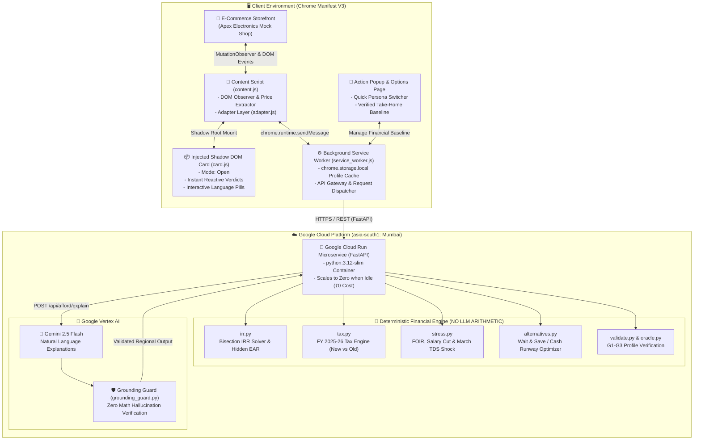

# Paylens — Real-Time E-Commerce Affordability Copilot

> **"Financial protection directly at checkout. Uncover deceptive EMI interest, stress-test your cash flow against income shocks, and get mathematically grounded purchase alternatives before you buy."**  
> Built for the **Digital Campus Hack Sprint** at Yenepoya University (Powered by GeeksforGeeks, FinTech Theme).

[](https://cloud.google.com)
[](https://www.python.org/)
[](https://developer.chrome.com/docs/extensions/)
[](https://pytest.org)
[](https://opensource.org/licenses/MIT)

---

### 🌐 Live Production Deployments

| Component | Target URL |
|---|---|
| **Production API (Cloud Run)** | **[https://paylens-986743332275.asia-south1.run.app](https://paylens-986743332275.asia-south1.run.app)** |
| **Flagship Demo Storefront** | **[https://paylens-986743332275.asia-south1.run.app/mock-shop/](https://paylens-986743332275.asia-south1.run.app/mock-shop/)** |
| **Interactive OpenAPI Docs** | **[https://paylens-986743332275.asia-south1.run.app/docs](https://paylens-986743332275.asia-south1.run.app/docs)** |
| **Health API** | **[https://paylens-986743332275.asia-south1.run.app/api/health](https://paylens-986743332275.asia-south1.run.app/api/health)** |

---

## 💡 The Problem & The Paylens Breakthrough

Modern e-commerce checkout is engineered to disguise true borrowing costs:
1. **The "0% No-Cost EMI" Illusion**: Lenders and e-commerce platforms bury mandatory processing fees and strip upfront instant cash discounts (₹2,000–₹5,000), turning advertised "0% interest" into hidden **24% to 36% Effective Annual Rates (EAR)**.
2. **Fixed Obligation to Income (FOIR) Blindspots**: Consumers purchase multiple high-ticket items across different sites without realizing their monthly debt obligations have quietly crossed the danger threshold (>35%–40% of net take-home).
3. **Cash-Flow Fragility**: Buyers fail to model sudden disruptions—a 20% salary cut or an acute March Q4 TDS tax deduction spike wipes out their free cash, triggering costly credit defaults.
4. **AI Hallucinations in Financial Advice**: Generic LLMs hallucinate calculations, offering inaccurate advice without grounding in tax code or cash flow mathematics.

### How Paylens Solves It
**Paylens** is a **Manifest V3 Chrome Extension** backed by a **deterministic Python FastAPI microservice on Google Cloud Run**:
- 🛡️ **In-Context Shadow DOM Verdict Card**: Injects directly below payment selectors on e-commerce storefronts without layout shift or styling interference.
- 🧮 **Deterministic Mathematical Core (Zero LLM Math)**: Every rupee, tax bracket under FY 2025-26 rules, bisection IRR calculation, and emergency runway metric is computed with 100% mathematical precision.
- ⚡ **Real-Time Debt & Shock Stress-Testing**: Dynamically models post-purchase Fixed Obligation to Income (FOIR) and stress-tests cash flow against salary cuts and March TDS deduction spikes.
- 🎯 **Intelligent Alternative Engine**: Automatically re-scores alternatives (e.g., *"Wait 3 Months & Buy in Cash"* to pocket discounts and protect emergency savings).
- 🧠 **Grounded Multilingual AI Explanations**: Uses Gemini 2.5 Flash through an enforceable Grounding Guard that rejects any response diverging from the deterministic numbers, falling back to instant regional templates in <500ms.

---

## 🏛️ System Architecture



---

## 🧮 Core Financial Formulations

### 1. Hidden APR & Effective Annual Rate (Bisection IRR Solver)
When a merchant advertises "0% No-Cost EMI", the consumer forfeits an upfront cash discount $D$ and pays an upfront processing fee $F$. The true periodic monthly rate $r$ is solved deterministically using bisection root-finding on Net Present Value:
$$\text{Upfront Price} - D + F = \sum_{t=1}^{n} \frac{\text{EMI}}{(1+r)^t}$$
$$\text{Effective Annual Rate (EAR)} = (1 + r)^{12} - 1$$
*Example*: On Sony WH-1000XM5 (₹29,990, 6-Month No-Cost EMI of ₹4,998/mo, ₹199 processing fee, ₹2,000 lost cash discount), Paylens computes an effective **30.74% EAR** and ₹2,235 markup!

### 2. Post-Purchase FOIR (Fixed Obligation to Income Ratio)
$$\text{FOIR} = \frac{\text{Committed Active EMIs} + \text{Proposed New EMI}}{\text{Net Monthly Take-Home}} \times 100$$
- 🟢 **COMFORTABLE**: $\text{FOIR} \le 35\%$, Emergency runway $\ge 3.0$ months, and uncommitted cash remains positive.
- 🟡 **STRETCH**: $35\% < \text{FOIR} \le 50\%$, OR emergency runway between $1.5$ and $3.0$ months.
- 🔴 **RISKY**: $\text{FOIR} > 50\%$, OR free cash becomes negative (monthly deficit), OR emergency runway $< 1.5$ months.

### 3. Income Disruption & March TDS Stress Testing
- **Acute Income Shock**: Simulates an immediate -20% salary cut:
  $$\text{Free Cash}_{\text{shock}} = (\text{Take-Home} \times 0.80) - \text{Essentials} - \text{Existing EMIs} - \text{New EMI}$$
- **March Q4 TDS Deductions**: Simulates Old Regime tax deduction spikes when investment/HRA proofs are unsubmitted, spreading unproven slab liabilities across Jan–Mar payroll.

---

## 🚀 Quickstart & Setup Guide

### 1. Run Backend Locally (Optional)
```powershell
# Clone repository
git clone https://github.com/Jagadish-s-naik/paylens.git
cd paylens

# Create virtual environment & install dependencies
python -m venv .venv
.\.venv\Scripts\activate
pip install -r requirements.txt

# Start FastAPI server
python -m uvicorn app.main:app --host 127.0.0.1 --port 8000 --reload
```
Navigate to `http://127.0.0.1:8000/mock-shop/` to open the local storefront.

### 2. Load the Unpacked Chrome Extension
1. Open Google Chrome and go to `chrome://extensions/`.
2. Enable **Developer mode** using the toggle switch in the top-right corner.
3. Click the **Load unpacked** button.
4. Select the `extension/` folder inside the `paylens/` project directory.
5. Paylens is now active! Click the extension icon in your toolbar to inspect your profile or open options.

### 3. Configure API Target
By default, [`extension/config.js`](file:///c:/xampp/htdocs/Paylens/extension/config.js) is pre-configured to point directly to the live Google Cloud Run production deployment:
```javascript
export const CONFIG = {
  API_BASE: "https://paylens-986743332275.asia-south1.run.app",
  MOCK_API: false,
  DEFAULT_LANGUAGE: "EN"
};
```
To point to your local backend, change `API_BASE` to `"http://127.0.0.1:8000"`.

---

## 🧪 Comprehensive Verification & Test Suite

### Full Automated Pytest Suite (64/64 Passing)
All 64 unit and integration tests across core financial math, API routes, and AI grounding pass with 100% reliability:
```bash
# Linux / macOS
.venv/bin/pytest

# Windows
.\.venv\Scripts\python.exe -m pytest
```

### End-to-End 7-Step Checklist Runner
```bash
# Against local FastAPI
.venv/bin/python scripts/verify_checklist.py

# Against Production Cloud Run
.venv/bin/python scripts/verify_checklist.py --url https://paylens-986743332275.asia-south1.run.app
```

| Test Module | Test Focus | Status |
|---|---|:---:|
| `tests/core/test_irr.py` | Bisection IRR solver, No-Cost EMI APR, lost discounts, fee handling | ✅ Passed (4/4) |
| `tests/core/test_tax.py` | FY 2025-26 New vs Old slabs, 87A rebate, marginal relief, Metro HRA | ✅ Passed (5/5) |
| `tests/core/test_stress.py` | FOIR calculation, salary cut disruption, March TDS spike | ✅ Passed (3/3) |
| `tests/core/test_alternatives.py` | Wait & Save optimizer, upfront cash savings, runway protection | ✅ Passed (2/2) |
| `tests/core/test_validate.py` | G1-G3 financial sanity checks, essential bounds | ✅ Passed (4/4) |
| `tests/core/test_oracle.py` | Golden profile take-home baselines (Rahul, Amit, Vikram) | ✅ Passed (4/4) |
| `tests/core/test_engine.py` | Full decision matrix synthesis, traffic light categorization | ✅ Passed (4/4) |
| `tests/core/test_architecture.py` | Boundary enforcement: zero AI imports in deterministic core | ✅ Passed (2/2) |
| `tests/api/test_routes_afford.py` | Affordability evaluation API, CORS, payload validation | ✅ Passed (8/8) |
| `tests/api/test_routes_profile.py` | Client profile retrieval, sync, and validation | ✅ Passed (5/5) |
| `tests/api/test_routes_listing.py` | Storefront mock product listings & payment options | ✅ Passed (2/2) |
| `tests/api/test_errors.py` | Strict UUID validation, 422 schema errors, 500 fallbacks | ✅ Passed (8/8) |
| `tests/api/test_integration_handshake.py` | Cross-service handshake, live mount verification | ✅ Passed (8/8) |
| `tests/ai/test_grounding_guard.py` | Gemini grounding guard, regex verification, anti-hallucination | ✅ Passed (5/5) |

---

## 🎤 60-Second Live Hackathon Pitch Script

An automated CLI coach validates all 14 spoken numbers in real time against live system APIs:
```bash
# Linux / macOS
.venv/bin/python scripts/rehearse_demo.py --auto

# Windows
.\.venv\Scripts\python.exe scripts/rehearse_demo.py --auto
```

### **Act 0: The Hook & Truth Layer (0:00 – 0:12)**
> *"Judges, headline CTC numbers deceive freshers. Rahul's offer letter advertised '12 LPA', but after stripping variable bonus and employer PF, Paylens scanned his payslip and proved his true take-home is exactly ₹75,000/month under FY 2025-26 rules."*
- **Visual Cue**: Show Options Page (`options.html`) with Rahul active; cursor highlights *Verified Take-Home: ₹75,000.00/mo*.

### **Act 1: Safe Purchase & Hidden EAR Reveal (0:12 – 0:26)**
> *"Rahul browses our electronics store to buy Sony WH-1000XM5 headphones (₹29,990) on a '0% No-Cost EMI' for ₹4,998/month. The Paylens extension triggers immediately: While budget-comfortable (FOIR 11.3%), Paylens reveals a 🔴 **30.74% Hidden EAR**! Taking No-Cost EMI forfeits a ₹2,000 cash discount and incurs processing fees, losing ₹2,235 in markup. Buying in cash preserves his ₹1.22L emergency cushion."*
- **Visual Cue**: Show Tab 1 on storefront; highlight the Crimson Callout *⚠️ High APR Financing Alert (30.74% EAR)* and cash alternative saving ₹2,235.

### **Act 2: Stress-Test Reality Check on iPhone 16 Pro (0:26 – 0:42)**
> *"Next, Rahul views the iPhone 16 Pro (₹1,19,900) on 6-month EMI at ₹19,983/month. Paylens shifts to 🟡 **Budget Stretch**! Look at the cash-flow impact: Debt ratio jumps to 31.3%, and free cash drops to just ₹11,017. Worse, an income stress test (-20% cut) triggers an immediate deficit of -₹3,983/month!"*
- **Visual Cue**: Switch to Tab 2 on storefront; cursor points to *Fails Shock (-₹3,983)* in the stress-test table.

### **Act 3: The Honest Alternative & Close (0:42 – 1:00)**
> *"Instead of forcing an unaffordable EMI or wiping out his emergency savings, Paylens offers a clear alternative: 'Wait 3 months, save ₹5,235'. By saving his uncommitted monthly cash for 3 months, he can buy the phone upfront in cash, pocket the ₹5,000 discount, and keep his 3.0-month emergency cushion 100% intact. Zero hallucinated math, 100% financial protection. Thank you!"*
- **Visual Cue**: Point to *Wait 3 Months & Buy in Cash* card; click language toggle (HI / KN) for instant grounded regional briefing.

---

## 💰 Cost Control: ₹0 Out-of-Pocket Spend

Paylens is built to run entirely within Google Cloud free tiers:
- **Cloud Run Serverless**: Configured with `--min-instances=0` (scales to zero when idle) and `--max-instances=1` (512Mi RAM).
- **Google Vertex AI**: `gemini-2.5-flash` with strict token limits (`max_output_tokens=1024`) and caching for regional dialects.
- **Client-Side Profile Storage**: Uses `chrome.storage.local` on the user's device, eliminating expensive remote database writes.

---

## 👥 Demo Personas Reference

| Persona | Profile & Income | Scenario & Product | Paylens Verdict & Insight |
|---|---|---|---|
| **Rahul Sharma** (Fresher) | ₹75,000/mo Take-Home<br>₹1.5L Savings, Metro Rent | Sony WH-1000XM5<br>₹29,990 (No-Cost EMI) | 🟢 **COMFORTABLE** (11.3% FOIR)<br>Exposes 🔴 **30.74% Hidden EAR** (saves ₹2,235 in cash). |
| **Rahul Sharma** (Fresher) | ₹75,000/mo Take-Home<br>₹1.5L Savings, Metro Rent | Apple iPhone 16 Pro<br>₹1,19,900 (6M EMI) | 🟡 **STRETCH** (31.3% FOIR)<br>Fails -20% income cut (-₹3,983 deficit); recommends *"Wait 3 Months & Buy in Cash"*. |
| **Amit Verma** (Entry Tech) | ₹40,000/mo Take-Home<br>₹25,000 Savings, 2 Active EMIs | ASUS ROG Strix G16<br>₹1,45,000 (12M EMI) | 🔴 **RISKY** (45.2% FOIR)<br>Immediate -₹2,400 monthly deficit; cash not possible today; recommends emergency fund first. |
| **Vikram Malhotra** (Senior) | ₹1,65,000/mo Take-Home<br>Old Tax Regime, ₹4.5L Savings | Apple iPhone 16 Pro<br>₹1,19,900 | 🟡 **STRETCH**<br>Fails March TDS Shock: *"₹127,800 March tax deduction spike"* due to unsubmitted proofs. |

---

## 📜 License & Acknowledgments
Released under the **MIT License**.  
Built with ❤️ for the **Digital Campus Hack Sprint** at Yenepoya University (Powered by GeeksforGeeks).
