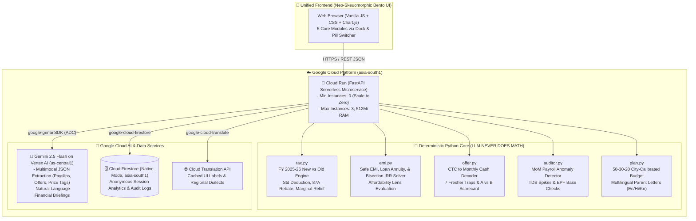

# Paylens — First Paycheck Copilot
> **"Understand your salary, decode your offer letters, and find out what you can actually afford."**
> Built for the **Digital Campus Hack Sprint** at Yenepoya University (Powered by GeeksforGeeks, FinTech Theme).

[](https://cloud.google.com)
[](https://www.python.org/)
[](https://opensource.org/licenses/MIT)

**Live Production URL:** [https://paylens-986743332275.asia-south1.run.app](https://paylens-986743332275.asia-south1.run.app)

---

## 💡 The Problem & The Solution
Fresh graduates and first-time earners in India face high financial confusion:
1. **The CTC Trap**: Headline CTC numbers look massive on paper (e.g., ₹14 LPA), but hide variable pay, joining bonus clawbacks, service bonds, and employer PF.
2. **The New vs Old Tax Dilemma**: Choosing the wrong tax regime under FY 2025-26 rules can cost a fresher ₹50,000+ per year.
3. **Deceptive "No-Cost EMI" Schemes**: BNPL & 0% EMI schemes secretly charge 24%+ annual interest by burying processing fees and stripping upfront cash discounts.
4. **Payroll Silent Errors**: Sudden March TDS tax spikes happen without a pay rise due to missed proof deadlines; PF is often miscalculated.
5. **Budget Guidance & Family Communication**: Freshers struggle to balance rent, savings, and explaining their finances to their parents back home.

**Paylens** is the all-in-one First Paycheck Copilot:
- 📄 **Module 1: Payslip Copilot** — Upload payslips with Gemini Vertex AI OCR, compare FY 2025-26 New vs Old tax slabs, view salary waterfall, and read 5-bullet briefings in English, Hindi, or Kannada.
- 💼 **Module 2: Offer Letter Decoder & Comparer** — Convert CTC into guaranteed cash in hand, automatically expose 7 fresher traps, and run side-by-side Offer A vs Offer B scorecards.
- 📷 **Module 3: Affordability Lens ("Snap & Decide")** — Instant traffic light verdict (🟢 Affordable / 🟡 Budget Stretch / 🔴 Don't Do It) on any price tag or EMI offer with salary burn and true APR solver.
- 🔍 **Module 4: Payslip Auditor** — Month-over-month payroll discrepancy detector for March TDS jumps, PF base mismatches, and 1-click HR grievance email generator.
- 🎯 **Module 5: Life Plan Mode** — 50-30-20 budget calibrated to Metro vs Tier-2 cities, 3-month emergency cushion runway, and a heartwarming 1-click WhatsApp "Explain to my parents" message in English, Hindi, and Kannada.

---

## 🏛️ System Architecture



### 🔒 Architectural Law: Zero Arithmetic by LLMs
Gemini **only** extracts raw fields from images/PDFs into typed Pydantic models at `temperature=0.0`, and explains numbers in clear language.
**Every rupee, tax bracket, IRR iteration, and audit discrepancy is calculated deterministically by Python engines with 100% unit test coverage.**

---

## 🧮 Core Financial Formulations

### 1. New vs Old Tax Engine (FY 2025-26)
- **New Tax Regime**: Standard deduction ₹75,000. Full rebate u/s 87A up to ₹12,00,000 taxable income with marginal relief.
- **Old Tax Regime**: Standard deduction ₹50,000. Section 10(13A) HRA exemption:
  $$\text{Exempt HRA} = \min(\text{Actual HRA}, \text{Rent} - 10\% \text{Basic}, 50\% \text{Basic (Metro)} \text{ or } 40\% \text{Basic (Non-metro)})$$
  Section 80C capped at ₹1,50,000. 4% Health & Education Cess applied.

### 2. No-Cost EMI True APR (Bisection IRR Solver)
Finds periodic monthly rate $r$ such that Net Present Value equals zero:
$$\text{Upfront Price} - \text{Discount} + \text{Fee} = \sum_{t=1}^{n} \frac{\text{EMI}}{(1+r)^t}$$
$$\text{Effective Annual Rate (EAR)} = (1 + r)^{12} - 1$$

### 3. The 7 Fresher Traps Engine
1. **Discretionary Variable Pay**: Flagged if variable pay > 15% of CTC.
2. **Service Bond Penalty**: Flagged if company mandates a bond tenure with financial penalty.
3. **Joining Bonus Clawback**: Flagged if 100% bonus is repayable upon exit within 12-24 months.
4. **Employer PF Inside CTC**: Clarifies that 12% employer PF is deferred retirement savings, not take-home pay.
5. **Gratuity Counted in CTC**: Highlights statutory 5-year continuous service rule before gratuity is payable.
6. **Notice Period Buyout Risk**: Exposes 90-day notice burdens that deter future recruiters.
7. **Paper Stock / ESOP Cliff**: Exposes 1-year vesting cliffs where departure leaves zero equity.

---

## 💰 Cost Control: ₹0 Out-of-Pocket Spend
Paylens is strictly architected within Google Cloud free tiers:
- **Cloud Run**: Min-instances 0 (scales to 0 when idle), 512Mi RAM.
- **Cloud Firestore**: Native mode in `asia-south1`, strictly bounded reads/writes.
- **Cloud Translation API**: Pre-cached in Python memory, 0 external API cost on repeated loads.
- **Gemini on Vertex AI**: `gemini-2.5-flash` with strict token bounding (`max_output_tokens=2048`), daily circuit breaker (300 calls/day), and IP rate limiters (20 requests/hour).

---

## 🧪 Comprehensive Test Suite (27/27 Tests Passing)
Run deterministic unit tests locally:
```bash
.\.venv\Scripts\pytest -o pythonpath=. -v
```
Test categories covered:
- `tests/test_tax.py`: 10L, 12L, 15L sanity checks, 87A rebate, marginal relief, Metro HRA exemption.
- `tests/test_emi.py`: Safe EMI 35% ratio, 36-month loan capacity, bisection IRR true-zero vs hidden interest.
- `tests/test_offer.py`: 7 fresher traps detection, Offer A vs Offer B cash comparison.
- `tests/test_auditor.py`: Month-over-month TDS spikes, EPF wage base compliance.
- `tests/test_plan.py`: Metro vs Tier-2 50-30-20 splits, Hindi/Kannada parent letter generation.
- `tests/test_api.py`: End-to-end FastAPI endpoint integration tests.

---

## 🎤 Hackathon 3-Minute Presentation Script

### **Minute 1: The Problem & The Fresher Trap (Hook)**
> *"Judges, when a fresher signs their first offer letter, they see '14 LPA' and think they've made it. Then they receive their first paycheck and find out their take-home is barely ₹54,000! Where did the money go?*
> *It went to 25% variable pay, employer PF counted inside CTC, and a 2-year service bond with a ₹2 lakh penalty.*
> *This is **Paylens** — the First Paycheck Copilot built on Google Cloud that protects young earners from financial traps."*

### **Minute 2: Live Demo — Offer Decoder & Affordability Lens**
> *(Module 1 & 2 Demo)* *"Watch: We decode an offer letter. Paylens calculates the real cash ratio (57%) and instantly flags 5 fresher traps with red badges. When we compare Offer A (14 LPA paper-heavy) against Offer B (11 LPA clean cash), Paylens proves that Offer B gives ₹14,000 MORE cash in hand every month!*
> *(Module 3 Demo)* *"Now, can this fresher buy the new iPhone 16 Pro on a 'No-Cost EMI'? We click the preset — Paylens runs a bisection IRR solver and shows a RED BANNER: 24.8% hidden APR! By taking EMI instead of upfront cash, you forfeit discounts and pay processing fees. That's higher than a personal bank loan."*

### **Minute 3: MoM Auditor, Life Plan, & ₹0 Cloud Engineering**
> *(Module 4 & 5 Demo)* *"Next, look at our Payslip Auditor: It detects a sudden +₹12,000 March TDS spike caused by missing 80C proofs and drafts a ready-to-send grievance email to HR.*
> *Finally, Life Plan Mode calibrates a 50-30-20 budget for Bangalore, builds a 3-month emergency safety net, and with 1 click generates an emotional WhatsApp update for their parents in native Hindi or Kannada.*
> *Every calculation is 100% deterministic Python. Gemini 2.5 Flash extracts the data, Cloud Run scales to zero, and the entire app costs ₹0 to host on Google Cloud. Thank you!"*

---

## 📜 License
MIT License. Built with ❤️ for Yenepoya University Digital Campus Hack Sprint.
