# PLAN.md: Parallel Execution Plan — Paylens Affordability Copilot

> **Status:** Living Execution Plan (Parallel Tracks through Live Convergence)  
> **Authority:** Strictly implements [`ARCHITECTURE.md`](file:///home/shamblonaut/dev/clones/paylens/ARCHITECTURE.md). All arithmetic and figures must match [`scripts/compute_fixtures.py`](file:///home/shamblonaut/dev/clones/paylens/scripts/compute_fixtures.py).  
> **Prerequisites Completed:** Phase 1 (Contracts + Pure Core + Architecture AST scan) is 100% complete and passing all 19 tests in `tests/core/`.

---

## 1. Working Agreements & Zero-Contention Protocol

To enable **Backend Core/AI (Track A)** and **Extension/Storefront (Track B)** to be developed **completely in parallel without file collisions or blocking dependencies**, both tracks adhere to the following decoupling protocol:

```
┌────────────────────────────────────────────────────────────────────────┐
│                        FROZEN CONTRACT BOUNDARY                        │
│                                                                        │
│   app/core/schemas.py (Pydantic source of truth: Profile, Listing,    │
│   Verdict, TrueCost, FinancialImpact, StressTestResult, Alternative)   │
│                                                                        │
│   scripts/compute_fixtures.py (Exact golden JSON numbers)              │
└───────────────────┬────────────────────────────────┬───────────────────┘
                    │                                │
         Track A (Backend & AI)           Track B (Extension & Storefront)
   ┌────────────────────────────────┐   ┌────────────────────────────────┐
   │ Files Owned:                   │   │ Files Owned:                   │
   │ - app/api/*                    │   │ - extension/*                  │
   │ - app/ai/*                     │   │ - mock-shop/*                  │
   │ - app/main.py, app/config.py   │   │                                │
   │ - tests/api/*, tests/ai/*      │   │ Decoupling Mechanism:          │
   │ - Dockerfile, deploy_to_cloud  │   │ - MOCK_API = true toggle       │
   │                                │   │ - Bundled golden fixtures      │
   │ Dev Cycle:                     │   │ - Standalone static mock-shop  │
   │ - Tested via pytest            │   │                                │
   │ - Early Cloud Run deploy       │   │ Dev Cycle:                     │
   │ - Zero extension dependency    │   │ - Tested directly in Chrome    │
   └────────────────────────────────┘   │ - Zero backend dependency      │
                                        └────────────────────────────────┘
                                    │
                                    ▼
                         Convergence & Handshake
                         - Flip MOCK_API = false
                         - Point to localhost:8000 or Cloud Run
                         - Run E2E Verification Checklist
```

### Core Non-Negotiable Rules

1. **Zero File Overlap**:
   - **Track A Engineer** exclusively touches: `app/api/`, `app/ai/`, `app/main.py`, `app/config.py`, `tests/api/`, `tests/ai/`, `Dockerfile`, `deploy_to_cloud.py`.
   - **Track B Engineer** exclusively touches: `extension/`, `mock-shop/`.
   - `app/core/` is frozen; changes require explicit stop-and-report alignment.
2. **Contract-First Mock Mode (`MOCK_API = true`)**:
   - Track B builds and tests the entire Extension (options onboarding, action popup, Open Shadow DOM card, DOM adapter) using local golden fixtures (`extension/mock_data.js` mirroring `scripts/compute_fixtures.py`). Track B is **never blocked** waiting for FastAPI routes or Vertex AI.
3. **Pure Core Invariance (Principle P1 & §4)**:  
   `app/core/` must **never** import from `app/ai/`, `app/api/`, `app/config.py`, `google*`, `fastapi`, `starlette`, `httpx`, `requests`, `os.environ`, or perform any file/network I/O. Enforced automatically by [`tests/core/test_architecture.py`](file:///home/shamblonaut/dev/clones/paylens/tests/core/test_architecture.py).
4. **LLMs Never Do Arithmetic (Principle P1)**:  
   Gemini only reads unstructured data (payslips, unstructured listings) and explains finished numbers. Every single financial metric displayed to the user must originate from `app/core/`. The explanation generator mechanically validates that every single number in generated bullets exists in the `Verdict` or `VerifiedProfile` via the Numeric Grounding Guard.
5. **Single Scoring Function Invariance (Principle P4 & §6)**:  
   Every option evaluation, stress test, and alternative purchase path **must** pass through the single scoring function `evaluate()` in [`app/core/engine.py`](file:///home/shamblonaut/dev/clones/paylens/app/core/engine.py).
6. **Graceful Degradation (Principle P5 & §11)**:  
   When `PAYLENS_OFFLINE=1` or Gemini is down, the system immediately degrades to static templates and pre-verified samples.

---

## 2. Track A: Backend API, AI & Cloud Run (Independent)

**Objective**: Expose the pure core calculation engine via a robust, stateless FastAPI backend with standardized error handling and rate-limiting for AI routes, wire the Gemini 2.5 Flash OCR and explanation pipeline with mechanical grounding guard, and verify deployment early via Cloud Run.

```
┌────────────────────────────────────────────────────────┐
│                      FastAPI App                       │
│  ┌───────────────────────┐   ┌──────────────────────┐  │
│  │   /api/afford (Pure)  │   │  /api/profile/build  │  │
│  │   - No rate limits    │   │  - Gemini OCR + G1-G3│  │
│  │   - < 50ms latency    │   │  - Multipart upload  │  │
│  │   - Pydantic contract │   │  - Zero persistence  │  │
│  └───────────────────────┘   └──────────────────────┘  │
│  ┌───────────────────────┐   ┌──────────────────────┐  │
│  │  /api/afford/explain  │   │  /api/demo/profiles  │  │
│  │  - En, Hi, Kn bullets │   │  - Rahul, Amit,      │  │
│  │  - Grounding Guard    │   │    Vikram personas   │  │
│  └───────────────────────┘   └──────────────────────┘  │
└────────────────────────────────────────────────────────┘
```

### Sub-stage A.1: API Error Envelope & Dependencies (`app/api/`)
- [ ] **Task A.1.1: Error Envelope & Custom Exceptions (`app/api/errors.py`)**  
  Implement the standard error envelope specified in [`ARCHITECTURE.md` §7.3](file:///home/shamblonaut/dev/clones/paylens/ARCHITECTURE.md#L206-L218):
  ```json
  { "error": { "code": "VALIDATION", "message": "...", "details": { "field": "..." } } }
  ```
  Define custom exception types: `PaylensAPIException`, `ValidationException` (422), `UnsupportedSchemaException` (422), `OptionNotFoundException` (404), `MissingInstallIdException` (400), `RateLimitedException` (429), `AIUnavailableException` (503). Ensure 500 internal errors never leak stack traces.
- [ ] **Task A.1.2: Settings & Configuration (`app/config.py`)**  
  Align `Settings` with [`ARCHITECTURE.md` §13](file:///home/shamblonaut/dev/clones/paylens/ARCHITECTURE.md#L386-L398): `GEMINI_MODEL`, `GEMINI_API_KEY`, `GOOGLE_CLOUD_PROJECT`, `GOOGLE_CLOUD_LOCATION`, `PAYLENS_OFFLINE` (default 0), `RATE_LIMIT_PER_HOUR` (default 20), `GEMINI_DAILY_CAP` (default 300), `CORS_ORIGINS`, `MAX_UPLOAD_MB` (default 5).
- [ ] **Task A.1.3: Security Headers & Rate Limiting (`app/api/deps.py`)**  
  Implement FastAPI dependencies:
  - `require_install_id`: Validates `X-Install-Id` UUID header on AI routes (`/api/afford/explain`, `/api/profile/build`, `/api/listing/parse`), returning `400 MISSING_INSTALL_ID` if absent. Logged only (optional) on `/api/afford`.
  - `check_ai_rate_limit`: Sliding-window in-memory limiter (20 req/hour per install ID) and global daily cap counter (300 req/day). Over limit → `429 RATE_LIMITED` with `Retry-After`.
  - Core route `/api/afford` and demo profiles route `/api/demo/profiles` are **unthrottled**.

### Sub-stage A.2: Core Affordability & Profile Routes
- [ ] **Task A.2.1: Deterministic Evaluation Route (`app/api/routes_afford.py`)**  
  Implement `POST /api/afford`:
  - Request body: `{ profile: VerifiedProfile, listing: Listing, selected_option_id: str }`.
  - Validate that `selected_option_id` exists in `listing.payment_options` (raise `404 OPTION_NOT_FOUND` if missing).
  - Recompute derived fields in `VerifiedProfile` and `effective_cash_price` in `Listing` (raise `422 VALIDATION` if client submitted conflicting figures per D8).
  - Call pure `engine.evaluate()` and `alternatives.generate_alternatives()`.
  - Return the completed `Verdict` contract. Target latency: **p95 < 50ms**, zero network calls, zero LLMs.
- [ ] **Task A.2.2: Demo Personas & Health Routes (`app/api/routes_profile.py`, `app/main.py`)**  
  - Implement `GET /api/demo/profiles`: Returns canonical personas matching `scripts/compute_fixtures.py` (Rahul Sharma, Amit Verma, Vikram Malhotra).
  - Implement `GET /api/health`: Returns `{ status: "ok", version: "1.0.0", ai_available: bool }`.

### Sub-stage A.3: FastAPI Assembly & Early Cloud Run Smoke Deploy
- [ ] **Task A.3.1: App Factory, CORS & Static Mount Setup (`app/main.py`)**  
  - Initialize FastAPI application with title `"Paylens API"`.
  - Configure CORS allowing `localhost`, Cloud Run origins, and `chrome-extension://*`.
  - Register custom exception handlers and request size limiter (6 MB max body).
  - Conditionally mount `mock-shop/` via `StaticFiles` if the directory exists (gracefully skips if Track B is still writing it).
- [ ] **Task A.3.2: Early Cloud Run Smoke Deployment (`paylens-smoke`)**  
  - Clean [`Dockerfile`](file:///home/shamblonaut/dev/clones/paylens/Dockerfile) (`python:3.12-slim`, minimal requirements).
  - Run [`deploy_to_cloud.py`](file:///home/shamblonaut/dev/clones/paylens/deploy_to_cloud.py) to provision `paylens-smoke` on Cloud Run (`asia-south1`, `--max-instances=1`).
  - Verify `GET /api/health` and `POST /api/afford` on the live Cloud Run URL.

### Sub-stage A.4: Multimodal Payslip Extraction (`app/ai/`)
- [ ] **Task A.4.1: Gemini Client Wrapper (`app/ai/client.py`)**  
  - Lazy initialization of `google.genai.Client` (Vertex AI ADC or `GEMINI_API_KEY`).
  - Enforce timeout (20s) and max 1 retry.
  - Implement circuit breaker: when `PAYLENS_OFFLINE=1` or daily cap exceeded, raise `AIUnavailableException(fallback="manual_entry")`.
- [ ] **Task A.4.2: Multimodal Payslip OCR & Sanity Gates (`app/ai/extract_payslip.py`, `app/core/validate.py`)**  
  - Extract structured JSON conforming to `PayslipData` schema: basic, hra, allowances, gross, pf, professional tax, tds, net pay.
  - Run deterministic validation gates G1–G3 (gross consistency, deductions consistency, net boundary). Flag inconsistent fields for user review without silently altering numbers.
- [ ] **Task A.4.3: Implement Profile Build Endpoint (`app/api/routes_profile.py`)**  
  - Implement `POST /api/profile/build`: Accepts multipart upload (`file` ≤ 5MB) + user inputs (tax regime, rent, savings, EMIs). Process in-memory only, return `{ profile, extraction, validation }`, zero disk/DB persistence. If `PAYLENS_OFFLINE=1`, return mock from `samples/ground_truth.json`.

### Sub-stage A.5: Numeric Grounding Guard & Regional Explanations
- [ ] **Task A.5.1: Grounding Guard & Explanations (`app/ai/explain.py`, `app/ai/templates.py`)**  
  - Define static template strings in English, Hindi, and Kannada.
  - Implement `generate_explanation(verdict, language, client)`:
    - Calls Gemini with `temperature=0` to generate 4–5 concise bullet points in target language.
    - **Numeric Grounding Guard**:
      1. Regex-extract all numbers (amounts, percentages, months) from the model output.
      2. Normalize formatting.
      3. Assert every extracted number appears in `verdict` or `profile` (within 1% rounding).
      4. If *any* number fails to match, discard Gemini output and return static template (`source: "template"`). Mechanical enforcement of P1!
- [ ] **Task A.5.2: Connect `/api/afford/explain` and Fallback Listing Route**  
  - Wire `POST /api/afford/explain` with rate limiting.
  - Implement `POST /api/listing/parse` in `app/api/routes_listing.py` (Gemini text-to-listing fallback).

### Sub-stage A.6: Backend Test Suite
- [ ] **Task A.6.1: API & AI Unit Tests (`tests/api/`, `tests/ai/`)**  
  - `tests/api/test_routes_afford.py`: Golden fixtures evaluation across Rahul Sony, Rahul iPhone, Amit Laptop.
  - `tests/api/test_errors.py`: Validation (422), Missing Option (404), Missing Install ID (400), Rate Limit (429).
  - `tests/ai/test_grounding_guard.py`: Assert guard rejects hallucinated numbers and accepts exact numbers (no live Gemini in CI).

---

## 3. Track B: Extension & Mock Storefront (Independent)

**Objective**: Deliver a zero-build, standalone Chrome Manifest V3 extension featuring an open Shadow DOM verdict card, a standalone Mock Storefront with `data-pl-*` DOM contracts, an Options Page for onboarding, and an Action Popup—fully testable in Chrome **using local mock fixtures without waiting for the backend**.

```
┌────────────────────────────────────────────────────────┐
│                   Chrome Browser (MV3)                 │
│                                                        │
│  [Standalone Mock Shop: mock-shop/index.html]          │
│   - Opens via file:// or lightweight local server      │
│   - iPhone 16 Pro, Sony WH-1000XM5, ASUS Laptop        │
│   - data-pl-* attributes & interactive radio drawers   │
│                                                        │
│  [Extension Service Worker: mock_data.js fallback]     │
│   - MOCK_API = true by default during development      │
│   - Returns golden verdicts instantly from local memory│
│                                                        │
│  [Injected Open Shadow DOM Card]                       │
│   - Scoped card.css (zero style leakage)               │
│   - Badge, True Cost (30.74% EAR), Impact, Stress, Alts│
│                                                        │
│  [Options Page: options/options.html]                  │
│   - Drag-and-drop payslip upload & review              │
│   - 1-click Demo Persona Pre-fill                      │
│   - Saves VerifiedProfile to chrome.storage.local      │
│                                                        │
│  [Action Popup: popup/popup.html]                      │
│   - Active take-home view & persona switcher           │
└────────────────────────────────────────────────────────┘
```

### Sub-stage B.1: Standalone Mock Storefront (`mock-shop/`)
- [x] **Task B.1.1: Build Standalone HTML Storefront (`mock-shop/index.html`)**  
  Build clean, responsive, realistic e-commerce product pages adhering strictly to [`ARCHITECTURE.md` §8.5](file:///home/shamblonaut/dev/clones/paylens/ARCHITECTURE.md#L290-L318):
  1. **Sony WH-1000XM5 Headphones**: List ₹29,990, Cash Discount ₹2,000 (Effective Cash ₹27,990).
     - Cash upfront: ₹27,990 (`data-pl-id="cash_upfront"`, `data-pl-type="CASH"`).
     - HDFC No-Cost EMI (6 months): ₹4,998.33/mo, Fee ₹199, Lost Discount ₹2,000 (`data-pl-id="hdfc_nocost_6m"`, `data-pl-type="NO_COST_EMI"`).
     - Standard EMI (12 months): ₹2,580/mo, 14% rate (`data-pl-id="standard_12m"`, `data-pl-type="STANDARD_EMI"`).
  2. **iPhone 16 Pro (128GB)**: List ₹119,900, Cash Discount ₹5,000 (Effective Cash ₹114,900).
     - Cash upfront: ₹114,900.
     - No-Cost EMI (6 months): ₹19,983.33/mo, Fee ₹199, Lost Discount ₹5,000 (`data-pl-id="hdfc_nocost_6m"`).
     - Standard EMI (12 months): ₹10,480/mo, 15% rate.
  3. **ASUS ROG Gaming Laptop**: List ₹140,000, Cash Discount ₹0 (Effective Cash ₹140,000).
     - Standard EMI (12 months): ₹13,258.24/mo, Fee ₹500, 15% rate (`data-pl-id="standard_12m"`).
  - Include `<div data-pl-mount></div>` target for card insertion.
- [x] **Task B.1.2: Storefront Styling & Interactive Drawer (`mock-shop/style.css`, `mock-shop/shop.js`)**  
  - Sleek modern e-commerce layout (gallery, product badges, payment selector).
  - Radio change handler: Updates `aria-checked="true"` on selected option. Dispatches custom `pl-option-changed` event to trigger adapter observation.

### Sub-stage B.2: Manifest & Offline Mock Bridge (`extension/`)
- [ ] **Task B.2.1: Manifest Declaration (`extension/manifest.json`)**  
  Per [`ARCHITECTURE.md` §8.1](file:///home/shamblonaut/dev/clones/paylens/ARCHITECTURE.md#L241-L247):
  - Permissions: `["storage"]`.
  - Host permissions: `["http://localhost:8000/*", "https://*.run.app/*"]`.
  - Content scripts: Matches `*://*/mock-shop/*` and `file:///*mock-shop/*`, script `["content/content.js"]`, `run_at: "document_idle"`.
  - Web accessible resources: `["content/card.css"]`.
  - Options page: `"options/options.html"`.
  - Action popup: `"popup/popup.html"`.
- [ ] **Task B.2.2: Extension Config & Golden Mock Fixtures (`extension/config.js`, `extension/mock_data.js`)**  
  - `extension/config.js`:
    ```javascript
    export const CONFIG = {
      API_BASE: "http://localhost:8000",
      MOCK_API: true, // Default true during parallel dev; flip to false for integration
      LANGUAGE: "en"
    };
    ```
  - `extension/mock_data.js`: Exports exact golden `Verdict` JSON objects from `scripts/compute_fixtures.py` for Rahul/Sony, Rahul/iPhone, Amit/Laptop, and Vikram/Shock. Enables instant extension testing with 0 backend dependencies!
- [ ] **Task B.2.3: Background Service Worker (`extension/background/service_worker.js`)**  
  - Initialize `paylens.installId` on install.
  - Implement message protocol:
    - If `CONFIG.MOCK_API === true`, return matching verdict from `mock_data.js` immediately.
    - If `CONFIG.MOCK_API === false`, dispatch `fetch(`${CONFIG.API_BASE}/api/afford`)` with 8s timeout and 1-retry.
    - Handlers for `PROFILE_GET`, `PROFILE_SET`, `DEMO_PROFILES`, `SETTINGS_GET/SET`.

### Sub-stage B.3: Storefront DOM Adapter (`extension/content/adapters/`)
- [ ] **Task B.3.1: Implement Mock Shop Adapter (`extension/content/adapters/mock_shop.js`)**  
  Implement the adapter contract from [`ARCHITECTURE.md` §8.4](file:///home/shamblonaut/dev/clones/paylens/ARCHITECTURE.md#L273-L289):
  - `matches(url)`: Returns true for `/mock-shop/*` or local file path containing `mock-shop`.
  - `extract(document)`: Parses `data-pl-product`, list price, cash discount, and payment options into a `Listing` structure. Returns `null` on failure (never throws).
  - `selectedOptionId(document)`: Returns `data-pl-id` of the option having `aria-checked="true"`.
  - `mountPoint(document)`: Locates `[data-pl-mount]` element.
  - `observe(document, onChange)`: Sets up `MutationObserver` on the options container with 150ms debounce. Returns cleanup disconnect function.

### Sub-stage B.4: Open Shadow DOM Verdict Card UI (`extension/content/`)
- [ ] **Task B.4.1: Scoped Card CSS & Shadow Root Host (`extension/content/card.css`, `extension/content/card.js`)**  
  - Inject open shadow root into `<div id="paylens-host">` at mount point.
  - Fetch `card.css` via `chrome.runtime.getURL` and inject directly inside the shadow root. Host page styles cannot bleed in or override!
  - Card states: `loading` (shimmer), `no-profile` (call-to-action button to options page), `error` (retry button), `verdict` (full breakdown).
- [ ] **Task B.4.2: Structured Financial Breakdown Hierarchy**  
  Render elements in strict order per [`ARCHITECTURE.md` §8.6](file:///home/shamblonaut/dev/clones/paylens/ARCHITECTURE.md#L321-L327):
  1. **Badge & Reason**: 🟢 `COMFORTABLE` / 🟡 `STRETCH` / 🔴 `RISKY` badge with clear headline reason.
  2. **True Cost Box**:
     - EAR % and Nominal APR %.
     - Outflow vs Cash price; Hidden Markup ₹.
     - **High APR Alert Banner**: Crimson callout when `true_cost.high_cost_alert == true` (e.g. Sony: *"⚠️ 30.74% Hidden EAR (₹2,235 lost markup)"*).
  3. **Impact Grid**: FOIR before $\to$ after; Free Cash remaining; Emergency Runway months.
  4. **Stress Test Rows**: -20% Income Cut status and deficit; March shock (rendered only when `applicable == true`).
  5. **Smart Alternatives**: Re-scored badges ("Buy in Cash Today", "Wait & Save" with dynamic roll-off, hypothetical part-payment). Infeasible options marked "Not possible today".
  6. **Assumptions Footer**: Collapsible heuristic notes & statutory financial disclaimer.
- [ ] **Task B.4.3: Content Script Orchestrator (`extension/content/content.js`)**  
  Connects adapter extraction, service worker messaging, and shadow DOM card updates.

### Sub-stage B.5: Options Page Onboarding & Profile Builder (`extension/options/`)
- [ ] **Task B.5.1: Build Onboarding UI (`options.html`, `options.css`, `options.js`)**  
  - **1-Click Demo Persona Buttons**: Instant buttons for *"Rahul (12 LPA Fresher)"*, *"Amit (Junior Dev)"*, and *"Vikram (Senior Dev)"*. Loads complete verified profile into `chrome.storage.local` instantly.
  - **Payslip Upload Dropzone**: Accepts PDF, PNG, JPG (≤ 5MB). In mock mode, pre-fills with ground truth sample data.
  - **Itemized Breakdown Review**: Form fields for basic, hra, gross, pf, pt, tds, and net verified in-hand.
  - **Financial Context Inputs**: Tax regime, monthly rent, metro toggle, current liquid savings, active EMIs table.
  - **Validation Banner**: Displays G1–G3 sanity check results.

### Sub-stage B.6: Action Popup & Persona Switcher (`extension/popup/`)
- [ ] **Task B.6.1: Build Inspection Widget (`popup.html`, `popup.css`, `popup.js`)**  
  - Lightweight instant-load widget:
    - User name and verified monthly take-home.
    - Emergency savings runway summary.
    - Committed active EMIs list.
  - Quick Persona Switch dropdown (instantly updates active profile in `chrome.storage.local`).
  - Button to open full options page (`chrome.runtime.openOptionsPage()`).

---

## 4. Phase 3: Track Convergence & Live Integration

**Objective**: Handshake Track A (Backend/AI) and Track B (Extension/Storefront), flip `CONFIG.MOCK_API = false`, verify full end-to-end functionality across all scenarios, deploy production Cloud Run, and rehearse the 60-second live presentation.

### Sub-stage 3.1: Service Handshake & Mock Mode Flip
- [ ] **Task 3.1.1: Mount Storefront in FastAPI & Toggle Extension**  
  - Confirm Track A mounts Track B's `mock-shop/` via `StaticFiles` in `app/main.py`.
  - In `extension/config.js`, set `MOCK_API = false` and set `API_BASE` to `http://localhost:8000`.
  - Start FastAPI server and load unpacked extension in Chrome.

### Sub-stage 3.2: End-to-End Verification Checklist (§3.7)
- [ ] **Task 3.2.1: Execute Mandatory 7-Step Verification Checklist**  
  1. Open `options/options.html` $\to$ click *"Load Rahul (Demo)"* $\to$ assert profile saved.
  2. Browse `http://localhost:8000/mock-shop/`.
  3. Inspect **Sony WH-1000XM5** (No-Cost EMI):
     - Assert badge: `COMFORTABLE` 🟢.
     - Assert High APR Alert: `30.74% EAR` and `₹2,235` markup alert displayed.
     - Assert Cash Alternative: Runway 3.01m, saving ₹2,235.
  4. Inspect **iPhone 16 Pro** (No-Cost EMI):
     - Assert badge: `STRETCH` 🟡.
     - Assert Free Cash drops to `₹11,017` and FOIR rises to `31.3%`.
     - Assert Income Shock fails: *"deficit of ₹3,983/month"*.
     - Assert Wait & Save: *"Wait 3 months, save ₹5,235"*.
  5. Switch persona to **Amit Verma** via action popup:
     - Inspect **Gaming Laptop**:
     - Assert badge: `RISKY` 🔴 with deficit `-₹2,400.00`.
     - Assert Cash purchase: *"Not possible today"*.
     - Assert recommendation: *"Build 3-Month Emergency Cushion First"*.
  6. Switch persona to **Vikram Malhotra**:
     - Inspect iPhone $\to$ Assert March TDS Shock fails with warning: *"₹127,800 March tax deduction spike"*.
  7. Toggle language to Kannada / Hindi:
     - Assert `/api/afford/explain` returns grounded regional bullets or template fallback in < 500ms.

### Sub-stage 3.3: Production Cloud Run Deployment
- [ ] **Task 3.3.1: Final Cloud Run Production Deploy**  
  - Run `python3 deploy_to_cloud.py` (`asia-south1`, `--max-instances=1`).
  - Update `extension/config.js` `API_BASE` to the Cloud Run HTTPS URL.
  - Run smoke test across `GET /api/health`, `POST /api/afford`, and `/mock-shop/`.

### Sub-stage 3.4: Live 60-Second Demo Rehearsal
- [ ] **Task 3.4.1: Rehearse Presentation with Exact Verified Numbers**  
  - **0:00–0:12 (The Hook & Truth Layer)**:  
    *"Judges, headline CTC numbers deceive freshers. Rahul's offer letter advertised '12 LPA', but after stripping variable bonus and employer PF, Paylens scanned his payslip and proved his true take-home is exactly ₹75,000/month under FY 2025-26 rules."*
  - **0:12–0:26 (Act 1: The Hidden APR Reveal on Sony Headphones)**:  
    *"Rahul browses our electronics store to buy Sony WH-1000XM5 headphones (₹29,990) on a '0% No-Cost EMI' for ₹4,998/month. The Paylens extension triggers immediately: While budget-comfortable (FOIR 11.3%), Paylens reveals a 🔴 **30.74% Hidden EAR**! Taking No-Cost EMI forfeits a ₹2,000 cash discount and incurs processing fees, losing ₹2,235 in markup. Buying in cash preserves his ₹1.22L emergency cushion."*
  - **0:26–0:42 (Act 2: The Stretch Reality Check on iPhone 16 Pro)**:  
    *"Next, Rahul views the iPhone 16 Pro (₹1,19,900) on 6-month EMI at ₹19,983/month. Paylens shifts to 🟡 **Budget Stretch**! Look at the cash-flow impact: Debt ratio jumps to 31.3%, and free cash drops to just ₹11,017. Worse, an income stress test (-20% cut) triggers an immediate deficit of -₹3,983/month!"*
  - **0:42–1:00 (Act 3: The Honest Alternative)**:  
    *"Instead of forcing an unaffordable EMI or wiping out his emergency savings, Paylens offers a clear alternative: 'Wait 3 months, save ₹5,235'. By saving his uncommitted monthly cash for 3 months, he can buy the phone upfront in cash, pocket the ₹5,000 discount, and keep his 3.0-month emergency cushion 100% intact. Zero hallucinated math, 100% financial protection. Thank you!"*

### Sub-stage 3.5: Final Polish & Repository Deliverables
- [ ] **Task 3.5.1: Clean Repository & Submission Check**  
  - Update [`README.md`](file:///home/shamblonaut/dev/clones/paylens/README.md) with demo script, architecture diagram, and unpacked extension install instructions.
  - Delete legacy files (`auditor.py`, `plan.py`, `offer.py`, `cross_check.py`).
  - Confirm `python3 -m pytest tests/core tests/api` passes 100%.

---

## 5. Technical Decisions Log (Resolutions for D11 & D12)

| # | Item | Status | Decision & Concrete Implementation |
|---|------|--------|------------------------------------|
| **D11** | **March TDS Shock Spreading & Capping** | **Resolved** | In [`app/core/stress.py`](file:///home/shamblonaut/dev/clones/paylens/app/core/stress.py), when Old Regime unproven slab liability triggers a March tax spike (e.g. Vikram's ₹127,800), we model it in two ways for total financial clarity:<br>1. *Acute single-month shock*: Free cash drops to deficit (`-₹111,183`), signaling immediate cash crunch.<br>2. *Display format in Card*: The warning explicitly communicates the root cause: *"Warning: Unsubmitted 80C/HRA proofs trigger a ₹127,800 March tax deduction spike (spreadable across Jan–Mar Q4 payroll)."* The test row is marked `applicable = false` for New Regime taxpayers $\le 12\text{L}$ where liability is ₹0. |
| **D12** | **Shadow Root Encapsulation Mode** | **Resolved** | Maintain `mode: "open"` on the shadow root throughout development and live demo. This allows seamless inspection in Chrome DevTools during judging and debugging. Transition to `"closed"` is deferred to a future post-hackathon store release. |

---

## 6. Parallel Sprint Schedule & Workstream Allocation

```mermaid
gantt
    title Paylens Parallel Sprint (Post-Phase 1)
    dateFormat HH:mm
    axisFormat %H:%M
    
    section Track A (Backend Core & AI)
    API Routes & Error Envelope (/api/afford)        :active, a1, 01:45, 03:00
    Early Cloud Run Smoke Deploy (paylens-smoke)    :        a2, 03:00, 03:30
    Gemini Payslip OCR & Validation Gates G1-G3     :        a3, 03:30, 04:45
    Grounding Guard & Regional Explanations         :        a4, 04:45, 05:45
    Backend API Tests & Hardening                   :        a5, 05:45, 06:15
    
    section Track B (Extension & Storefront)
    Standalone Mock Shop (HTML/CSS & data-pl-*)     :active, b1, 01:45, 02:45
    Extension Manifest, Mock Fixtures & SW Bridge   :        b2, 02:45, 03:45
    Open Shadow DOM Card UI & Scoped CSS            :        b3, 03:45, 05:00
    Options Onboarding & Action Popup               :        b4, 05:00, 06:15
    
    section Convergence & Demo
    Handshake & Toggle MOCK_API = false             :        c1, 06:15, 06:45
    Production Cloud Run Deploy & Smoke Test        :        c2, 06:45, 07:15
    Offline Resilience & 60-Second Demo Rehearsal   :        c3, 07:15, 08:00
```



### Team Workstream Assignment

| Role | Lead | Focus Areas & Deliverables |
|:---|:---|:---|
| **Track A: Backend & AI** | Engineer 1 | - `app/api/errors.py`, `app/api/deps.py`, `app/api/routes_afford.py`<br>- `app/ai/extract_payslip.py`, `app/core/validate.py`<br>- `app/ai/explain.py` with Numeric Grounding Guard & templates<br>- Early and Production Cloud Run deployments |
| **Track B: Extension & Storefront** | Engineer 2 | - `mock-shop/index.html`, `style.css`, `shop.js`<br>- `extension/manifest.json`, `mock_data.js`, `service_worker.js`<br>- `extension/content/card.js`, `card.css`, `adapters/mock_shop.js`<br>- `extension/options/options.html`, `extension/popup/popup.html` |
| **QA, Integration & Presentation** | Engineer 3 | - Verify test suites (`tests/api/`, `tests/ai/`)<br>- Execute 7-step E2E Verification Checklist (§3.2)<br>- Offline resilience test (`PAYLENS_OFFLINE=1`)<br>- Stage & time the 60-second live demonstration script |

---

## 7. Must-Ship Cut Line vs Upside Items

| Layer | Must-Ship Demo Cut Line (Non-Negotiable) | Upside Items (Drop if Pressed for Time) |
|:---|:---|:---|
| **Backend Core** | 100% pure `app/core` passing all tests; `/api/afford` p95 < 50ms | Dynamic variable bonus haircut tuning |
| **Storefront** | Complete static `/mock-shop` with Sony, iPhone, and Gaming Laptop | Live DOM scraping on Amazon.in / Flipkart |
| **Extension** | Open Shadow DOM card on mock shop reading from `chrome.storage.local` | Custom themes or animated card collapse |
| **Truth Layer** | Options page with 1-click sample payslip load and manual review | OCR correction of skewed mobile camera photos |
| **Explanations** | Grounded explanation bullets in English with template fallback | Dynamic Kannada audio voiceover |
| **Alternatives** | Re-scored "Buy in Cash Today" and "Wait & Save" with dynamic roll-off | Hypothetical Downpayment split-tender calculations |
| **Infrastructure** | Containerized FastAPI on Cloud Run with `PAYLENS_OFFLINE=1` fallback | Multi-region Cloud Run replication |
